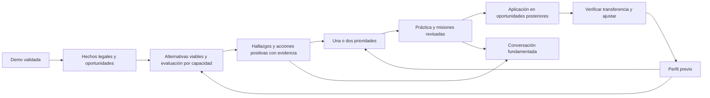

# Definición canónica del producto: AI Coach de CS2

| Campo | Valor |
|---|---|
| Estado | Canónico |
| Versión | 1.3 |
| Fecha | 22 de septiembre de 2026 |
| Equipo objetivo | Dos personas |
| Inversión | Por etapas según evidencia de utilidad; presupuesto ampliable sin autorización automática de gasto |
| Documento de ejecución | [AI_COACH_IMPLEMENTATION_PLAN.md](AI_COACH_IMPLEMENTATION_PLAN.md) |

## Cómo usar este documento

Este fichero define qué producto estamos construyendo, qué promete al usuario y qué límites debe respetar. Debe leerse antes del plan de implementación.

No contiene el backlog ni refleja el estado diario del desarrollo. Esas cuestiones pertenecen al documento de implementación. Si ambos documentos entran en conflicto, este documento decide el comportamiento del producto y el plan decide únicamente cómo construirlo.

Sustituye como fuente de verdad a:

- `AI_COACH_ARCHITECTURE.md`;
- `docs/AI_COACH_MASTER_PLAN.md`;
- `docs/AI_COACH_ML_DATA_AND_TRAINING_ARCHITECTURE.md`.

Los informes de auditoría y contratos de datos permanecen como evidencia técnica, pero no pueden ampliar por sí solos el alcance del producto.

---

## 1. Decisión de producto

StratAI será un coach personalizado pospartida que acompaña la mejora del jugador. Analizará demos completas, localizará decisiones relevantes, reconocerá errores y acciones positivas respaldados por evidencia y propondrá alternativas realizables con la información razonable disponible en cada momento.

**Fuente del análisis, reiterada por el usuario el 22/09/2026:** la replay de la
partida real (`.dem`), descargada o ya disponible. Este recorrido no incorpora
grabación de pantalla en la web, no exige vídeos personales de los jugadores y
no genera partidas o muestras artificiales para obtenerlos. Los clips o vistas
de evidencia mencionados en este documento deben proceder de la replay. Cuando
una información concreta no pueda acreditarse desde las fuentes admitidas, se
conserva su incertidumbre sin convertir una grabación del jugador en requisito
del producto. Esta restricción no modifica los hechos ni autoriza inferencias
de percepción, entrenamiento o adquisiciones masivas.

El ciclo de producto será:

**Partida → perfil contextual → una o dos prioridades → práctica y misiones → verificación en oportunidades posteriores → ajuste del plan.**

Cada prioridad unirá una observación verificable, una conducta que merezca mantener o cambiar, una explicación adaptada al jugador y una forma de practicar y comprobar su evolución. El coach distinguirá entre comprender una decisión, poder ejecutarla y mantener el hábito en partidas reales. Completar un ejercicio no prueba por sí solo que se haya aprendido.

El usuario debe sentir que el coach ha visto su partida y comprende sus hábitos, no que está recitando reglas genéricas.

El producto tendrá dos flujos distintos que compartirán exactamente el mismo contrato canónico de Go:

1. **Demos FACEIT para aprendizaje:** no tienen un jugador principal por defecto; sirven para construir datasets, referencias y modelos globales.
2. **Demos del usuario para coaching:** tienen un jugador principal identificado de forma segura; sirven para aplicar los modelos, construir su perfil y generar recomendaciones.

Las demos del usuario no entrarán automáticamente en el entrenamiento global. Su reutilización exigirá consentimiento, anonimización, controles de calidad, versionado y posibilidad de retirada.

La primera validación será un **piloto privado de Mirage asistido por coaches humanos**, centrado en economía, apoyo al compañero y mecánica observable, con perfil y plan de práctica desde el inicio. Peek/hold/reposición conserva su función de prueba técnica espacial; su automatización completa no es un requisito indiscriminado para probar una capacidad independiente.

El **coach integral de Mirage** seguirá siendo la primera entrega pública del producto. El piloto privado no se presentará como coach completo ni acreditará capacidades automáticas que aún no existan. Cada consejo del piloto conserva los mismos límites de evidencia, viabilidad y abstención; la intervención humana no rellena hechos ausentes.

El catálogo final de capacidades y sus necesidades de datos se diseña completo. Su ejecución por etapas no reduce ese alcance ni autoriza por sí sola entrenamiento, adquisición o publicación.

---

## 2. Promesa central

> **No hay error sin una acción mejor respaldada.**

Si el sistema no puede identificar una alternativa disponible con un valor esperado superior, no puede presentar la acción observada como un error. Podrá describir el evento, señalar riesgo o pedir más contexto, pero deberá abstenerse de corregirlo.

Toda corrección prescriptiva responderá:

1. ¿Qué hizo el jugador?
2. ¿Qué muestra el proxy como observable o razonablemente inferible en `T0`?
3. ¿Qué alternativas eran físicamente y tácticamente posibles?
4. ¿Cuál es la mejor alternativa estimada?
5. ¿Dónde y cuándo debía ejecutarse?
6. ¿Por qué tiene más valor esperado?
7. ¿Qué diferencia estimada existe?
8. ¿Qué evidencia y situaciones comparables la respaldan?
9. ¿Con qué confianza se afirma?
10. ¿Qué información haría cambiar la recomendación?

Una observación sin alternativa accionable no ocupará uno de los hallazgos principales de la partida.

El producto no puede reconstruir la mente, la atención ni la comunicación del jugador. Usará un `observable_proxy`: visión reconstruida, información de objetivo, estados propios y aliados, contactos previos y demás hechos cuya disponibilidad pueda probarse. Sonido, voz e intención quedan fuera. La redacción dirá «información disponible según la demo» y no «sabías» cuando no exista evidencia de conocimiento subjetivo.

---

## 3. Qué significa «la mejor jugada»

La mejor jugada no es la acción perfecta reconstruida después de conocer la posición real de todos los enemigos. Es la acción con mayor valor esperado entre las alternativas respaldadas, dadas:

- la información observable o razonablemente inferible en `T0`;
- la geometría y el tiempo disponible;
- el inventario y la economía;
- la posición y capacidad de apoyo de los compañeros;
- el nivel de incertidumbre;
- la capacidad de ejecución estimada del jugador;
- la cobertura existente en los datos.

En estos documentos, «causal» significa que la información era legal en `T0` y que no existe fuga de futuro. No significa que una demo observacional demuestre por sí sola qué habría ocurrido al intervenir y elegir otra acción. El valor será inicialmente una estimación condicional respaldada por soporte, overlap, reglas y revisión humana; nunca se presentará como un futuro alternativo observado.

La selección se formaliza como:

$$
a^* = \arg\max_{a \in A_{soportadas}(s)}
\left[V(s,a,p)-\lambda_u U(s,a)-\lambda_o OOD(s,a)\right]
$$

Donde:

- `s` es el estado observable o belief state en `T0`;
- `a` es una acción candidata viable;
- `p` es el perfil de ejecución del jugador;
- `V` es el valor esperado;
- `U` es la incertidumbre;
- `OOD` penaliza acciones fuera del soporte del dataset.

### 3.1 Tres resultados posibles

El recomendador podrá concluir:

1. **Una acción claramente superior:** se ofrece como recomendación principal.
2. **Dos o más acciones equivalentes:** se presentan como opciones condicionadas; no se inventa un ganador.
3. **Cobertura insuficiente:** el sistema se abstiene de llamar error a la acción.

### 3.2 Recomendaciones condicionales

La táctica no siempre es una orden cerrada. El coach podrá producir políticas sencillas:

> Mantén la posición mientras no haya contacto en B. Si se confirman al menos dos rivales, rota por spawn. Si solo aparece una utilidad, conserva el control de tu zona.

### 3.3 Personalización de la acción óptima

Una jugada de alto valor para un profesional puede no ser la de mayor valor para otro jugador. El coach ajustará el ranking por:

- probabilidad personal de ganar ese tipo de duelo;
- arma y situación;
- consistencia mecánica;
- rutas y posiciones dominadas;
- uso de utilidad;
- errores de ejecución recurrentes.

La recomendación debe ser ambiciosa pero ejecutable para la persona que la recibe.

La alternativa apropiada para jugar hoy y la habilidad que conviene desarrollar son decisiones distintas. El plan puede enseñar una acción todavía difícil para el jugador sin recomendar que la fuerce durante una ronda. El perfil describe capacidades y patrones por contexto; no encasilla a la persona en un rol, estilo o nivel permanente.

### 3.4 Dónde interviene el criterio humano

La máquina acredita hechos recomputables: geometría y colisiones, visibilidad física, FOV/humo, estado de arma, NAV, conectividad, recorridos, inventario y outcomes observados. Una persona no certifica rayos, polígonos o distancias que el sistema puede validar automáticamente.

El ground truth humano compara decisiones tácticas completas. El revisor recibe sólo la información legal en `T0`, la acción realizada y alternativas ya filtradas como físicamente viables; puede preferir una, declararlas equivalentes, rechazar todas o abstenerse por contexto insuficiente, y registra razones y confianza. Se crea una muestra inicial antes del primer recomendador y, más adelante, se añaden lotes seleccionados por incertidumbre, desacuerdo, rareza y OOD junto con una cuota aleatoria.

Las respuestas se versionan y controlan antes de un reentrenamiento offline. No existe aprendizaje online directo desde un clic, y el test humano bloqueado nunca se reutiliza para entrenar, seleccionar casos o ajustar thresholds.

---

## 4. Resultado esperado para el usuario

Después de procesar una partida, el producto mostrará como máximo tres correcciones prioritarias, hasta dos acciones positivas cuando estén respaldadas y un patrón longitudinal cuando haya suficiente historial.

De esa revisión saldrán como máximo una o dos prioridades activas, acordes con el tiempo disponible y los objetivos del jugador. Cada una tendrá práctica o misión, criterio de oportunidad y una próxima revisión. Puede mantenerse una prioridad entre partidas; el sistema no inventará un problema nuevo para renovar el informe.

Cada corrección incluirá:

- ronda y momento exacto como localizador del clip, no como afirmación de que el jugador conocía ese reloj exacto;
- acción observada;
- mejor acción estimada;
- lugar, margen temporal cualitativo y condición de ejecución;
- diferencia de valor o categoría comparativa;
- separación entre decisión y ejecución;
- clip, replay o eventos de evidencia;
- recurrencia personal;
- confianza y limitaciones;
- regla práctica o ejercicio.

Ejemplo de salida objetivo:

> **Entrada sin conexión en connector, ronda 18.** La flash del compañero ya estaba en vuelo y era observable en `T0`; la mejor alternativa estimada era esperar brevemente para entrar con ella. El peek inmediato te exponía a dos ángulos y dejaba al compañero demasiado lejos para un trade limpio. Aunque ganaste el primer duelo, la decisión tenía menor valor esperado. Este patrón aparece seis veces en tus últimas ocho partidas de Mirage. Confianza media-alta.

Los relojes exactos de la demo y los cálculos de ETA —*estimated time of arrival*, tiempo estimado de llegada— pueden existir como señales internas. No representan lo que el jugador sabía con precisión ni predicen cuánto tardará realmente entre paradas, combates, limpieza de ángulos, aceleración o cambios de arma. El coach no dirá «tardabas exactamente 15 segundos» ni deducirá automáticamente «debías guardar» a partir de esa cifra. Comunicará margen amplio, suficiente, ajustado, crítico, inviable o desconocido, de forma condicional. Una referencia optimista que ya excede el margen puede ayudar a descartar una acción; que una referencia optimista quepa en el margen no demuestra por sí sola que la acción fuese viable. Si la conclusión cambia con supuestos razonables, se expresa con incertidumbre o se abstiene.

---

## 5. Cobertura integral y orden de incorporación

StratAI debe llegar a valorar todas las áreas relevantes que una demo permita observar con seguridad. El alcance se diseña completo desde el principio, aunque sus especialistas se construyan y validen por etapas.

«Valorar todo» no significa inventar lo que la demo no contiene. Significa cubrir todo lo observable, indicar la confianza y abstenerse en lo que dependa de intención, voz, atención mental, entrada exacta de teclado o ratón, sonido subjetivo o futuros que no ocurrieron.

| Entrega | Propósito | Cuándo termina |
|---|---|---|
| Contrato integral | Definir todas las capacidades, decisiones, acciones, datos, límites y modelos | Cada familia tiene contrato y matriz de datos, aunque todavía no esté implementada |
| Piloto privado asistido | Validar en Mirage economía, apoyo y mecánica observable mediante revisión humana, perfil y práctica; peek sigue como prueba espacial | Cada consejo pasa los requisitos de su capacidad y se comprueban comprensión, aplicación y seguimiento del plan |
| Coach integral de Mirage | Cubrir el núcleo completo de coaching observable en Mirage | Todas las familias activas pasan su gate propio y se integran en un único informe |
| Expansión multimapa | Repetir geometría, zonas, corpus y evaluación por mapa | Cada mapa supera su gate antes de publicar recomendaciones |

Las pruebas técnicas y el piloto privado producen evidencia para construir el producto. No acreditan por sí solos cobertura integral ni publicación. El plan fija qué puede probarse en cada momento y sus dependencias reales.

### 5.1 Combate y mecánica observable

- Colocación de la mira y preparación del ángulo.
- Movimiento al disparar, parada y estabilidad medible.
- Primer disparo, ráfaga, spray, recarga y cambio de arma.
- Selección de objetivo y adaptación después del contacto.
- Separación entre una mala elección de duelo y una ejecución deficiente.

Las afirmaciones se adaptarán a la resolución real de la demo. No se publicarán milisegundos, teclas o movimientos de ratón que el contrato no pueda demostrar.

### 5.2 Peeks, duelos, cobertura y exposición

- Hacer peek, mantener, repetir, cambiar de ángulo o retirarse.
- Anchura del peek y exposición simultánea a varios ángulos.
- Uso de cobertura, posiciones previsibles y rutas de salida.
- Relación entre arma, distancia, vida, utilidad y riesgo del duelo.
- Reposicionamiento después de revelar información.

### 5.3 Juego en equipo, spacing, trade e impacto

- Entrar sin conexión real de trade.
- Romper el espaciado o llegar tarde al apoyo.
- Crossfires, dobles peeks y sincronización observable.
- Distinguir una entrada útil de una muerte sin consecuencias.
- Valorar kill, trade, espacio, objetivo y supervivencia después del contacto.
- Recomendar esperar, apoyar, reagruparse, avanzar o retroceder.

La existencia de un compañero vivo no equivale por sí sola a capacidad de trade. Deben considerarse distancia, tiempo, geometría, orientación y obstáculos.

### 5.4 Utilidad

- Elegir entre usar, retrasar, conservar o coordinar una utilidad.
- Flashes que ayudan, llegan tarde, ciegan al equipo o no tienen continuación.
- Smokes, molotovs y granadas según trayectoria, zona, timing y efecto observable.
- Morir con utilidad relevante sin usar.
- Facilitar una entrada, cruce, plantado, postplant o retake.

Se juzgarán hechos y consecuencias observables, no la intención real del lanzamiento.

### 5.5 Economía y conservación de recursos

- Comprar, hacer compra parcial, eco, force o save.
- Coherencia entre la compra individual y la del equipo.
- Drops, protección de armas y valor perdido.
- Consecuencias sobre rondas posteriores.
- Elección de arma y utilidad según rol, dinero y situación.

El objetivo será estimar valor esperado de ronda y partido, no aplicar una etiqueta rígida de «compra correcta».

### 5.6 Información disponible y respuesta

- Qué amenazas eran visibles o razonablemente inferibles en `T0`.
- Contactos anteriores, última posición conocida y antigüedad de la información.
- Reacción a información observable del objetivo y de los compañeros.
- Ignorar una amenaza disponible según el proxy o reaccionar a información todavía no disponible.

Voz, intención y experiencia auditiva subjetiva quedan fuera mientras no exista un contrato fiable. La redacción hablará de «información disponible según la demo», no de lo que el jugador pensaba o sabía.

### 5.7 Rotaciones y control del mapa

- Rotar demasiado pronto, demasiado tarde o por una ruta insegura.
- Abandonar, recuperar o duplicar innecesariamente una zona.
- Sobre-rotaciones y margen de llegada cualitativo; los escenarios numéricos de ETA son sólo apoyo interno.
- Relación entre información disponible, control aliado, bomba y distribución del equipo.
- Mantener, ceder, recuperar o intercambiar espacio.

Las zonas, conexiones y rutas son clasificaciones propias de StratAI construidas sobre geometría y navegación; no se asumirán como hechos directos de demoinfocs.

### 5.8 Bomba, objetivos y gestión del tiempo

- Transporte, caída y recuperación de la bomba.
- Momento y lugar de plantado.
- Protección del plantado y estructura de postplant.
- Retake, intento de defuse o save.
- Uso del margen temporal, kit, utilidad, distancias y rutas alcanzables sin atribuir conciencia exacta del reloj al jugador.
- Abandono correcto de un objetivo que ya no es recuperable.

### 5.9 Ventaja, riesgo y situaciones especiales

- Conservación o pérdida de una ventaja numérica.
- Riesgo innecesario o pasividad perjudicial.
- Decisiones de clutch y situaciones de inferioridad.
- Priorización entre supervivencia, daño, espacio, objetivo y economía.
- Acción positiva aunque la ronda se pierda y acción débil aunque la ronda se gane.

La victoria de ronda es una señal importante, pero nunca la única definición de una buena decisión.

### 5.10 Evolución del jugador

- Errores y fortalezas repetidos por mapa, lado, zona, arma y fase.
- Diferencias entre decisión y ejecución.
- Tendencias recientes y comparación con jugadores de contexto similar.
- Prioridades de entrenamiento y ejercicios concretos.
- Mejora o empeoramiento posterior a una recomendación.

Esta capacidad es transversal: usa únicamente partidas anteriores a la recomendación evaluada y se contrae hacia el baseline global cuando hay poco historial.

---

## 6. Separación entre decisión y ejecución

Toda situación tendrá dos evaluaciones independientes.

### Valor de decisión

Se calcula antes de observar el resultado mecánico e incluye:

- información disponible;
- posición y timing;
- apoyo y tradeability;
- economía e inventario;
- alternativas viables;
- probabilidad de consecuencias favorables.

### Calidad de ejecución

Evalúa cómo se llevó a cabo la acción:

- movimiento;
- crosshair;
- reacción;
- precisión y spray;
- uso de utilidad;
- adaptación después del contacto.

Esto permite cuatro conclusiones:

| Decisión | Ejecución | Interpretación |
|---|---|---|
| Buena | Buena | Acción repetible que debe reforzarse |
| Buena | Mala | Idea correcta; hay que entrenar la ejecución |
| Mala | Buena | Resultado positivo no repetible; no reforzar el hábito |
| Mala | Mala | Prioridad alta de corrección |

---

## 7. Contrato mínimo de una recomendación

Cada recomendación existirá primero como un objeto verificable, antes de redactarse en lenguaje natural.

```text
recommendation_id
player_id_pseudonymous
match_id / round_id / t0
decision_type
task_eligibility
observable_state_ref
belief_state_ref
observed_action
candidate_actions[]
recommended_action
where
when
execution_conditions[]
value_taken
value_recommended
estimated_value_delta
comparison_basis
counterfactual_status
uncertainty
abstention_reason
support_count
support_band
effective_sample_size
similar_case_ids[]
evidence_ids[]
decision_score
execution_score
personal_pattern_ref
limitations[]
model_and_contract_versions
```

`comparison_basis` distinguirá como mínimo `verified_dominance_rule`, `observational_value_model`, `human_review_supported` y `ope_supported`. `counterfactual_status` dejará claro que una alternativa es estimada y no observada.

Una corrección solo es publicable si:

- la acción recomendada era viable en `T0`;
- no depende de información futura u oracle;
- tiene evidencia trazable;
- supera el margen mínimo frente a la acción observada;
- está dentro del soporte aceptado;
- su confianza supera el umbral del tipo de decisión.

---

## 8. Personalización

### 8.1 Perfil desde la primera experiencia

El piloto privado ya incluirá un perfil sencillo y trazable. El jugador podrá indicar objetivos, tiempo disponible y preferencias; las demos aportarán fortalezas, dificultades y oportunidades observadas por mapa, lado, zona, arma, economía, fase y compañía. Los datos declarados y los observados conservarán fuentes distintas.

Con poco historial se muestran hipótesis provisionales y referencias generales prudentes. Un patrón exige repetición en partidas y oportunidades comparables, con incertidumbre visible; un número de partidas por sí solo no acredita una capacidad ni obliga a usar un modelo más complejo. El sistema compartirá modelos o reglas generales y ajustará el perfil con regularización, sin entrenar un modelo por usuario.

El prior usado para evaluar una partida sólo contiene su pasado. Una vez cerrada la revisión, esa partida puede actualizar el perfil que orienta el siguiente plan. El usuario podrá inspeccionar los casos que sostienen un patrón y borrar su historial conforme a la política de privacidad.

### 8.2 Una o dos prioridades y un plan realizable

El coach revisará todas las familias soportadas y elegirá una o dos prioridades activas según importancia, recurrencia por oportunidad, confianza, capacidad de mejora, requisitos previos y esfuerzo. Incluirá fortalezas que convenga mantener. Adaptará dificultad y carga a la persona, sin asumir que imitar una acción profesional sea su mejor opción actual.

La biblioteca de prácticas comenzará con ejercicios y variantes revisados por coaches. Cada práctica o misión tendrá objetivo, evidencia de origen, condiciones de aplicación y excepción, dificultad, dedicación orientativa y criterio de revisión. Podrá consistir en comprender una situación, practicar su ejecución o aplicar una conducta cuando aparezca una oportunidad en partida. El LLM explicará y adaptará la presentación de este contenido; no inventará su eficacia ni sus criterios de éxito.

La misión nunca prevalece sobre el objetivo de la ronda o una decisión mejor respaldada. No se exige acercarse siempre al compañero, sobrevivir a toda costa o gastar utilidad para completar una tarea. Si no aparece una oportunidad válida, se registra «sin oportunidad» y no un fracaso. El jugador puede ajustar la carga o aportar contexto sin que eso se convierta en una etiqueta táctica automática.

### 8.3 Verificar aprendizaje y ajustar

Se distinguirán práctica asignada, práctica declarada o verificada, rendimiento en el ejercicio y transferencia a nuevas partidas. El progreso se medirá en oportunidades comparables, considerando dificultad y contexto; se comprobará también después de retirar ayudas y tras un intervalo. Una caída de oportunidades porque el jugador evita participar no cuenta como mejora.

Una práctica completada, una kill, el K/D, el rango o la victoria no demuestran por sí solos que el plan funcione. El seguimiento mostrará conducta, oportunidades, incertidumbre y posibles efectos adversos sobre otras áreas. Si no hay señal suficiente, el coach mantendrá el plan, lo simplificará o pedirá más evidencia; no afirmará mejora ni empeoramiento por obligación.

Aprender qué acción era preferible y aprender qué práctica mejora a una persona requieren evidencias distintas. El historial pedagógico conservará qué plan se ofreció, qué se hizo y qué ocurrió después. La adaptación del plan mediante reglas revisadas no equivale a reentrenar modelos globales: cualquier aprendizaje de modelos seguirá siendo offline, versionado y evaluado antes de su promoción.

---

## 9. Coach conversacional

El usuario podrá conversar de forma natural sobre una ronda, una recomendación o su evolución.

Preguntas objetivo:

- «¿Por qué dices que esta entrada fue mala?»
- «Pero conseguí matar al primero, ¿no compensó?»
- «¿Qué tenía que hacer exactamente?»
- «¿Por qué mantener era mejor que rotar?»
- «¿Me ocurre habitualmente?»
- «Enséñame tres casos similares.»
- «¿Qué debería entrenar esta semana?»
- «¿Está mejorando este problema?»

### 9.1 Arquitectura del diálogo

El LLM no analizará directamente demos o JSON crudo. Consultará herramientas internas:

```text
get_match_summary
get_round_state
get_recommendation
get_evidence_window
find_similar_situations
compare_player_baseline
get_player_trend
explain_metric
```

El LLM recibirá hechos, alternativas, confianza y limitaciones ya calculadas. Su función será:

- explicar;
- responder preguntas de seguimiento;
- adaptar profundidad y tono;
- explicar prácticas y misiones revisadas y seleccionadas para el jugador;
- reconocer contradicciones;
- abstenerse cuando falte evidencia.

### 9.2 Dos clases de conversación

1. **Sobre las partidas del usuario:** siempre respaldada por herramientas y evidencia.
2. **Sobre conocimiento general de CS2:** identificada como orientación general, no como conclusión extraída de la demo.

La memoria conversacional y el perfil táctico serán stores separados. El usuario podrá borrar ambos.

### 9.3 Contexto aportado y corrección del coach

El jugador podrá aclarar una decisión o cuestionar el análisis. «Mi compañero me pidió esperar» se conservará como contexto declarado, con autoría y momento, no como un hecho extraído de la demo ni una entrada retrospectiva del snapshot T0. El coach podrá revisar su interpretación de forma condicional, explicar qué cambia y qué sigue sin poder comprobar.

Una respuesta del usuario no modifica la evidencia original, no convierte una preferencia en verdad táctica ni actualiza un modelo global. Los desacuerdos pueden enviarse al flujo de revisión autorizado y las correcciones conservan trazabilidad. Las preferencias de práctica sí pueden ajustar el siguiente plan sin fingir una nueva validación científica.

---

## 10. Arquitectura del ciclo de coaching



Los hechos y filtros físicos, el juicio táctico, el perfil y la elección de prácticas son responsabilidades distintas. Cada una conserva evidencia, incertidumbre y límites. El piloto puede apoyarse en coaches para valorar decisiones y preparar planes; debe identificar esa intervención y conservar registros que permitan evaluar su futura automatización.

Las reglas, referencias estadísticas, recuperación de casos y modelos especialistas compiten por mejorar resultados medidos. Ninguna familia tiene obligación de entrenar un modelo si una regla revisada resuelve su tarea. El Evidence Pack separa el análisis del lenguaje; el LLM explica y conversa sin decidir por sí solo qué acción era mejor.

Los contratos de datos y la biblioteca de prácticas se conservan al automatizar más trabajo. Se podrá sustituir un método de evaluación o selección sin perder historial, evidencia ni criterios de aprendizaje. La [arquitectura de modelos](ai-coach/AI_COACH_MODEL_ARCHITECTURE.md) compara las opciones técnicas y el [plan](AI_COACH_IMPLEMENTATION_PLAN.md) fija su orden y gates; este esquema define el comportamiento objetivo, no componentes ya disponibles.

---

## 11. Taxonomía de acciones objetivo

El espacio de acciones será pequeño y jerárquico. No se intentará representar cada movimiento de ratón.

El contrato integral definirá desde el principio todas las familias. El piloto privado seleccionará acciones de economía, apoyo y mecánica observable que puedan reconstruirse y revisarse con seguridad; peek conserva una prueba técnica espacial separada. El coach integral de Mirage no estará terminado hasta activar el núcleo completo con un gate independiente por familia.

### Posicionamiento

- `hold_position`
- `delay_action`
- `advance_to_zone`
- `fall_back_to_zone`
- `reposition_within_zone`
- `regroup_with_teammate`
- `support_teammate`

### Combate

- `take_duel`
- `avoid_duel`
- `hold_angle`
- `first_peek`
- `repeat_peek`
- `wide_peek`
- `jiggle_for_information`
- `change_angle`
- `stop_before_shooting`
- `continue_burst`
- `reset_spray`
- `reload_now`
- `delay_reload`
- `wait_for_trade_connection`

### Utilidad

- `use_utility_now`
- `delay_utility`
- `save_utility`
- `use_utility_for_zone`
- `use_utility_for_teammate`
- `use_utility_for_objective`

### Economía

- `full_buy`
- `partial_buy`
- `eco`
- `save_equipment`
- `drop_equipment`

### Información, rotación y control

- `hold_map_control`
- `take_map_control`
- `cede_map_control`
- `rotate_to_site`
- `delay_rotation`
- `cancel_rotation`
- `choose_safe_route`

### Objetivo y tiempo

- `attempt_objective`
- `abandon_objective`
- `plant_now`
- `delay_plant`
- `protect_planter`
- `hold_postplant`
- `start_retake`
- `attempt_defuse`
- `save_from_retake`

Las acciones concretas incluirán zona, ruta, timing y condiciones cuando los datos lo permitan. Una acción presente en la taxonomía no queda automáticamente autorizada para recomendarse: debe ser físicamente posible, estar soportada por datos comparables y superar el gate de su familia y mapa.

---

## 12. Alcance de las primeras entregas

### 12.1 Piloto privado de Mirage asistido por humanos

El piloto debe comprobar el ciclo de coaching con participantes informados de su alcance y de la intervención humana:

- situaciones verificables de economía, apoyo al compañero y mecánica observable, con requisitos propios por capacidad;
- una alternativa viable y respaldada por cada corrección;
- ejemplos positivos que merezca conservar, sin confundir un resultado favorable con una buena decisión;
- evidencia navegable en replay;
- decisión y ejecución separadas;
- perfil inicial, una o dos prioridades, práctica y misiones con condiciones y excepciones;
- seguimiento de oportunidades posteriores, incluida la ausencia de oportunidad;
- incertidumbre, abstención y evidencia que el lenguaje no pueda alterar.

Los coaches validarán diagnósticos y prácticas; los jugadores permitirán comprobar comprensión, aplicación y carga. Se evaluará por separado la transferencia del aprendizaje. La muestra y los umbrales viven en el plan y se fijan antes de evaluar, sin confundir una prueba exploratoria con validación suficiente para publicación.

Peek/hold/reposición continúa como prueba técnica para hechos espaciales y alternativas. No bloqueará capacidades independientes cuando sus requisitos estén satisfechos; tampoco se presentará como resuelto mientras falte evidencia. El piloto no promociona el corpus, modelos ni soporte público de forma implícita.

### 12.2 Coach integral de Mirage

La primera versión presentable como coach debe integrar, con profundidad proporcional a la evidencia disponible:

- combate y mecánica observable;
- peeks, duelos, posicionamiento, cobertura y exposición;
- spacing, trades, apoyo e impacto de entry;
- utilidad;
- economía;
- información disponible;
- rotaciones y control del mapa;
- bomba, postplant, retake, save y tiempo;
- gestión de ventaja, riesgo y clutch;
- patrones longitudinales del jugador;
- prioridades, prácticas y misiones adaptadas, con verificación y ajuste en partidas posteriores.

Cada familia tendrá elegibilidad, dataset, modelo o regla, umbral de confianza, test humano y posibilidad de abstención propios. «Integral» significa que todas las áreas están representadas y que el sistema puede juzgarlas cuando hay evidencia; no significa que deba inventar un hallazgo en cada ronda.

La experiencia seguirá mostrando como máximo tres correcciones prioritarias y hasta dos acciones positivas por partida, convertidas en una o dos prioridades activas. El sistema reunirá las capacidades en un informe y un plan de mejora coherentes.

### 12.3 Expansión a otros mapas

Mirage será el primer mapa completo. El pipeline puede procesar otros mapas para validar robustez, pero no publicará recomendaciones específicas hasta que cada combinación mapa-familia supere sus gates de geometría, zonas, datos, modelo y revisión humana.

---

## 13. Fuera de la primera versión integral

- Offline reinforcement learning.
- World model general de CS2.
- Transformer o GNN sobre partidas completas.
- Entrenamiento de un modelo por usuario.
- Coaching en tiempo real.
- Razonamiento fiable sobre voz e intención del equipo.
- Afirmaciones exactas sobre teclas, ratón, atención mental o sonido subjetivamente percibido.
- Afirmaciones al jugador de segundos exactos de llegada o de conciencia exacta del reloj; esos valores sólo pueden ser anclas o señales internas con incertidumbre.
- Simulación exacta de futuros.
- Recomendaciones fuera del soporte observado.
- Servidor GPU permanente.
- Entrenamiento o alojamiento de un LLM propio.
- Arquitectura Kubernetes o MLOps gestionado.
- Afirmaciones de optimalidad absoluta.

Estas posibilidades solo se revisarán si un baseline más sencillo demuestra una limitación medible y el producto ya tiene usuarios.

---

## 14. Reglas de comunicación

El coach deberá:

- hablar de acciones y evidencia, no de culpabilidad;
- distinguir hecho, derivación e inferencia;
- usar la información disponible en `T0` al valorar la decisión;
- poder usar el futuro únicamente para explicar consecuencias;
- indicar confianza;
- reconocer alternativas equivalentes;
- reconocer cuando no sabe;
- corregirse si una pregunta revela una evidencia omitida;
- evitar precisión falsa;
- convertir cada recomendación en una conducta entrenable.

No podrá afirmar:

- intención del jugador o del equipo sin evidencia;
- conocimiento de un enemigo oculto;
- causalidad a partir de una correlación aislada;
- que una acción fue errónea solo porque la ronda se perdió;
- que una acción fue correcta solo porque produjo una kill.

---

## 15. Métricas de éxito del producto

Antes de ampliar la arquitectura, el coach integral de Mirage debe alcanzar objetivos acordados en un piloto. Los umbrales de promoción se versionarán antes de abrir el test y no se ajustarán después de ver sus resultados. Se medirán al menos:

- porcentaje de correcciones aceptadas como correctas por revisión humana;
- porcentaje considerado útil y accionable;
- fidelidad entre explicación y evidencia;
- porcentaje de errores que incluyen alternativa viable;
- cobertura de partidas con al menos un hallazgo de confianza alta;
- tasa de abstención correcta;
- tasa de alternativas fuera de distribución;
- recurrencias personales confirmadas;
- uso de preguntas de seguimiento;
- cambio del patrón por oportunidad comparable en partidas posteriores;
- comprensión del consejo y aplicación de las prácticas;
- transferencia a situaciones nuevas y mantenimiento sin ayudas;
- dificultad y carga adecuadas, ausencia de oportunidad y efectos sobre otras capacidades;
- coste y latencia por partida.

La prioridad será precisión sobre cobertura. Cero hallazgos es preferible a un consejo falso. La finalización de tareas y la satisfacción se medirán aparte de la mejora demostrada. K/D, rango y winrate son señales complementarias: no sustituyen la calidad de decisión ni acreditan por sí solos el efecto del entrenamiento.

---

## 16. Restricciones de equipo y presupuesto

Decisiones vigentes:

- Dos personas deben poder comprender y mantener todo el sistema.
- El presupuesto es ampliable por etapas según la evidencia de utilidad; el antiguo techo de 1.000 EUR deja de definir el alcance.
- El plan concreta los escenarios de validación y sus costes, separando gasto externo y trabajo de los fundadores. Una previsión de presupuesto no autoriza contratación, compras ni consumo de servicios.
- La inversión se prioriza en coaches, jugadores, datos válidos y evaluación longitudinal antes de automatizar más trabajo.
- CPU local es el punto de partida. Una GPU puntual o propia sólo se considerará si una prueba demuestra su beneficio y el coste total resulta justificado; disponer de presupuesto no obliga a usarla.
- Cada servicio adicional necesita una razón medible y un límite de coste.
- No se plantea entrenar un modelo gigante ni un LLM propio como requisito para este producto.

El plan mantiene escenarios, mediciones y decisiones de inversión. Toda complejidad debe justificar una mejora medible; las horas de coaches, jugadores y fundadores se contabilizan aunque no todas impliquen un pago externo.

---

## 17. Decisiones no negociables de la primera versión integral

1. No hay error sin una alternativa mejor respaldada.
2. La recomendación usa información legal en `T0`.
3. Oracle y estado observable permanecen separados.
4. El LLM no decide qué acción era mejor.
5. El ranking penaliza incertidumbre y acciones OOD.
6. Decisión y ejecución se evalúan por separado.
7. La personalización empieza con regularización, no con fine-tuning por jugador.
8. El catálogo integral de capacidades, datos y límites se define antes de entrenar o ampliar el corpus.
9. Cada familia tiene contrato, elegibilidad, método de análisis evaluado —regla o modelo—, métricas y gate propios.
10. Se comparan reglas y modelos tabulares especialistas antes de usar deep learning.
11. FACEIT se usa como factoría offline de datos, no como dependencia del runtime web.
12. Las demos del usuario y las de entrenamiento comparten extractor, pero no finalidad ni consentimiento.
13. Demos, datasets y modelos no se versionan en Git.
14. El producto puede abstenerse.
15. Cada claim debe ser trazable a evidencia y versión.
16. Los hechos geométricos y NAV se validan automáticamente; el humano juzga decisiones tácticas contextualizadas, no números aislados.
17. Toda etiqueta humana entra por un dataset versionado y evaluación offline; si se usa para entrenar, el entrenamiento también es offline. Nunca actualiza producción de forma inmediata.
18. Perfil, prioridades y prácticas forman parte del piloto desde el inicio, con alcance e incertidumbre explícitos.
19. Cada misión define oportunidades y excepciones; no incentiva perjudicar al equipo para mejorar una métrica.
20. Contexto declarado por el usuario, hechos de demo y evaluación humana mantienen su procedencia separada.
21. La eficacia de una práctica se verifica aparte de la corrección del consejo y de la finalización de la tarea.

---

## 18. Cuándo revisar esta definición

Solo se revisará el alcance si ocurre alguno de estos eventos:

- el coach integral no puede producir alternativas útiles con el espacio de acciones actual;
- el baseline tabular alcanza un techo demostrado;
- el corpus supera el volumen y diversidad definidos en el plan;
- el piloto valida demanda de una capacidad fuera de alcance;
- cambia de forma material el acceso a demos o el contrato de datos;
- se amplía el equipo o el presupuesto.

Una nueva técnica no constituye por sí sola una razón para ampliar la arquitectura.

---

## 19. Definiciones de terminado

### 19.1 Piloto privado asistido

El piloto privado estará evaluado cuando sus capacidades priorizadas puedan:

1. reconstruir una decisión causal de Mirage;
2. comparar la acción observada con alternativas físicamente válidas;
3. separar decisión y ejecución;
4. abrir la evidencia correcta en el replay;
5. expresar incertidumbre y abstenerse bajo revisión humana;
6. construir un perfil provisional y proponer una o dos prioridades con prácticas revisadas;
7. comprobar comprensión, aplicación, oportunidades y transferencia posterior con los criterios fijados en el plan;
8. distinguir resultados exploratorios de los benchmarks necesarios para automatizar o publicar.

El cierre registra también si la hipótesis de utilidad fue refutada o quedó inconclusa. La intervención humana debe quedar identificada; este resultado no autoriza a describir StratAI como coach integral ni como un sistema completamente automático.

### 19.2 Coach integral de Mirage

La primera versión del producto estará terminada cuando un usuario pueda:

1. procesar una partida compatible de Mirage;
2. recibir una valoración conjunta de todas las familias enumeradas en la sección 5;
3. recibir hasta tres correcciones priorizadas y hasta dos acciones positivas respaldadas;
4. ver la acción observada y la mejor alternativa estimada cuando exista;
5. comprobar el momento y los hechos en el replay;
6. distinguir decisión de ejecución;
7. entender confianza, soporte y limitaciones;
8. preguntar y repreguntar al coach sin que el LLM invente el juicio;
9. consultar patrones construidos solo con su pasado;
10. obtener una o dos prioridades y un plan de práctica/misiones adaptado a sus capacidades, objetivos y disponibilidad;
11. ver una abstención clara cuando la demo o los datos no permiten juzgar;
12. recibir recomendaciones solo de familias que hayan superado su gate propio;
13. comprobar la aplicación por oportunidad, incluida la ausencia de oportunidad, y consultar cómo se ajusta el plan;
14. distinguir práctica completada de aprendizaje observado en partidas posteriores.

Todas las familias deben estar representadas. Una familia puede abstenerse en un caso concreto, pero no puede omitirse del producto porque nunca se diseñó, midió o evaluó.

Ese resultado, y no la complejidad de los modelos, define el éxito de la primera versión integral.
