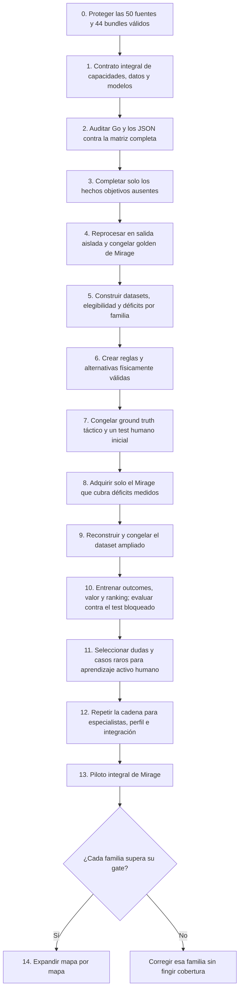

> **ARCHIVO HISTÓRICO — NO EJECUTABLE.** Instantánea del plan v1.18 anterior a la revisión del coach integral. Sus marcas de estado, presupuesto, gates y siguiente acción describen aquel momento; no gobiernan el trabajo actual. Consulta el [plan activo](../../AI_COACH_IMPLEMENTATION_PLAN.md). Archivar este documento no cierra 1B.12 ni acredita la limpieza pendiente.

# Plan canónico de implementación del AI Coach

| Campo | Valor |
|---|---|
| Estado | Activo |
| Versión | 1.18 |
| Fecha | 5 de septiembre de 2026 |
| Producto que implementa | [AI_COACH_PRODUCT_DEFINITION.md](../../AI_COACH_PRODUCT_DEFINITION.md) |
| Equipo | Dos personas |
| Límite antes del piloto | 1.000 EUR de gasto externo acumulado |
| Primera entrega | Vertical técnico de Mirage para trade/spacing y peek/hold/reposición; el primer producto publicable será el coach integral de Mirage |

## Cómo mantener este plan

- Este documento contiene orden, tareas, gates y evidencias de implementación.
- `[x]` significa implementado y verificado en el código o corpus actual.
- `[ ]` significa pendiente; una implementación parcial continúa pendiente.
- No se inicia una fase de entrenamiento si el gate de datos anterior no ha pasado.
- No se descargan miles de demos para descubrir después que el contrato no permite reprocesarlas.
- Cada cambio de schema debe actualizar versión, manifest, golden corpus y dataset.
- Los resultados de experimentos se registrarán como artefactos reproducibles, no como afirmaciones en este documento.
- El catálogo de capacidades se diseña completo antes de entrenar; los especialistas se implementan y promueven por etapas.
- Objetivo contractual: una demo podrá ser elegible para una familia y no para otra. El flag actual `usable_for_training` sigue existiendo, pero no autoriza por sí solo todos los usos y deberá migrarse a elegibilidad por tarea.
- Cerrar una fase siempre obliga a actualizar aquí versión, estado, checks verificados, evidencias y una única siguiente acción, aunque no cambie el contrato del producto.
- Todo cierre funcional que cambie parsing, exportadores, schemas, contratos runtime o hechos derivados debe ejecutar, después de los tests, un smoke real sobre exactamente una demo aprobada. La entrada y los 44 bundles son de sólo lectura; la salida es nueva, temporal, aislada y no publicable. Si falla, se corrige y se repite la misma demo, no se busca otra verde. El cierre registra alias, checksum, comando, versiones, duración, conteos, abstenciones y hashes, y comprueba el artefacto afectado más allá del código de salida.
- El smoke de una demo no autoriza reprocesado 44/44, descarga, entrenamiento, release, publicación, promoción ni mutación de `CURRENT`; tampoco sustituye los gates formales de migración.
- El mismo cierre registra comandos y blockers, traslada el resultado al informe y al plan, elimina el prompt ejecutado y enlaza un único prompt vigente desde este plan y el README.

### Jerarquía documental

- [Definición de producto](../../AI_COACH_PRODUCT_DEFINITION.md): promesa, alcance y límites; sólo cambia si cambia una decisión real de producto.
- Este plan: única fuente para progreso, tareas pendientes, gates y siguiente acción.
- [Contrato humano](../../AI_COACH_CAPABILITY_AND_DATA_CONTRACT.md): significado de capacidades y datos.
- [Catálogo máquina](../../../ai_coach/contracts/capability_catalog.json): IDs y referencias consumibles por software.
- [Arquitectura de modelos](../../ai-coach/AI_COACH_MODEL_ARCHITECTURE.md): referencia técnica; no mantiene progreso.
- Auditorías fechadas y `docs/evidence/`: pruebas inmutables del estado observado.
- Las dependencias técnicas diagnosticadas en Gate 1A se conservan en la sección 19 de este plan, no en un backlog paralelo.
- `docs/prompts/`: contiene únicamente la siguiente instrucción ejecutable enlazada desde «Próxima acción concreta». Los prompts ejecutados se eliminan tras trasladar su resultado al informe y al plan.

---

## 1. Orden de ejecución



El camino crítico es:

1. catálogo integral de capacidades y límites observables;
2. contratos de decisiones, acciones, outcomes y abstención por familia;
3. matriz campo→procedencia→partición causal→cobertura→consumidor;
4. extractor factual común para demos FACEIT y demos de usuario;
5. elegibilidad y dataset causal verificables por tarea;
6. reglas, generadores de alternativas y filtros físicos anteriores a cualquier juicio táctico humano;
7. ground truth humano inicial sobre decisiones completas, con un test bloqueado antes de entrenar el recomendador;
8. adquisición de Mirage guiada por déficits medidos, nunca por un contador aislado;
9. cadena completa por especialista: outcomes, modelo si aporta valor, ranking, evidencia, abstención y gate;
10. aprendizaje activo por lotes sobre incertidumbre, desacuerdo, rareza y OOD, siempre con versionado y reentrenamiento offline;
11. integración, personalización y conversación fundamentada;
12. promoción mapa por mapa.

Las dos familias actuales son el primer vertical técnico porque permiten comprobar la cadena con un coste controlado. No son la definición de terminado del producto.

Los contratos, loaders y validadores de assets espaciales se diseñan agnósticos al mapa, mientras cada paquete factual se implementa y valida automáticamente por separado. La semántica nominal o táctica que no sea derivable conserva contrato, fuente y gate propios. Durante el vertical inicial, Mirage es la primera referencia real; un mapa sin paquete versionado y evidencia propia permanece no soportado y `unavailable`. Esta extensibilidad no adelanta la promoción mapa por mapa del paso 14.

El chat no debe adelantarse al motor de recomendación. Conversar es relativamente sencillo; fundamentar una corrección es la parte difícil.

---

## 2. Punto de partida verificado

Este inventario refleja el cierre reproducible del smoke de Mirage del 26 de agosto de 2026. Antes de una operación futura se volverá a comprobar en modo de solo lectura. Para mantenimiento mandan los manifests, hashes, contratos y release registrados, no un contador escrito en este documento.

### 2.1 Corpus local

| Medida | Estado verificado |
|---|---:|
| Demos fuente nuevas en `Faceit-Demos/demos/` | 50 |
| Mapa | Mirage |
| Bundles canónicos aprobados | 44 |
| Exclusiones seguras conservadas | 6 |
| Formato de los 44 bundles | `3.8.0` |
| `observed.jsonl.gz` | Presente en 44 de 44 |
| Decisiones causales | 36.181 |
| `spacing_or_trade_connection` | 26.648 |
| `peek_hold_or_reposition` | 9.533 |
| Release offline verificada | `stratai-2c6db440231d463a` |
| Staging | Vacío al cierre |
| Entrenamiento autorizado | No |

Las seis exclusiones no se fuerzan dentro del corpus: cuatro contienen identidad activa no reconciliable de bots y dos atribución no segura de la bomba. Permanecen disponibles para robustez y diagnóstico.

El inventario de cierre contiene 3.113 archivos y 40.853.375.267 bytes, aproximadamente 38,048 GiB, con digest global `1fdf935036ecb52e244b05c8246bdd046d1f40a1cc27720202185d9589850865`. La evidencia completa está en `../../Faceit-Demos/docs/MIRAGE_SMOKE_50_ACCEPTANCE_2026-08-26.md`.

Conclusiones:

- Las 44 partidas sirven para auditar contratos, reconstrucción, cobertura y reglas; no son un corpus suficiente para entrenar el coach integral.
- El lote es intencionadamente Mirage-only. La diversidad de mapas se añadirá después, con un gate independiente por mapa.
- El antiguo snapshot local de 296 bundles y `golden-demos-v2` se conserva únicamente como evidencia histórica. Sus fuentes se borraron de forma deliberada al reiniciar el corpus.
- No se buscarán las antiguas 51 fuentes salvo que el usuario indique expresamente que existe una copia que desea recuperar.
- Las fuentes actuales formarán el candidato a golden de Mirage. El contrato `3.8.0` todavía fija `golden-demos-v2` en lineage y validación; no se sustituirá su significado en silencio.
- Gate 1A debe diseñar una migración versionada de registro golden, lineage, validador, tests y release. Solo después podrá promoverse el golden de Mirage y añadirse un golden de transferencia por cada mapa posterior. Se decidirá expresamente si esa migración exige o no cambiar `3.8.0`.

### 2.2 Extractor Go

El export canónico actual contiene una base valiosa:

| Dominio | Fuente actual | Utilidad para el coach |
|---|---|---|
| Contexto | `core/match.json`, `participants.json`, `rounds.json` | Joins, mapa, equipos, lados, relojes y resultado |
| Combate | `events/combat_events.jsonl` | Disparos, daño, kills, arma, reload, switch, reacción y outcomes |
| Utilidad | `events/utility_events.jsonl` | Lanzamiento, trayectoria, lifecycle, flashes, daño y afectados |
| Objetivo | `events/objective_events.jsonl` | Plant, defuse, abortos, explosión y carrier |
| Estado táctico | `states/tactical/observed.jsonl.gz`, `oracle.jsonl.gz`, `gaps.jsonl.gz` | Base causal a 16 Hz con particiones físicas separadas; debe auditarse campo por campo |
| Estado descriptivo | `states/player_states/round_*.jsonl` | Posición y estado a 2 Hz; útil para agregados, insuficiente para timings finos |
| Replay | `presentation/replay/round_*.json.gz` | Proyección de interfaz a 16 Hz; no es la entrada causal del modelo |
| Engagements | `derived/engagements.json` | Outcomes de combate; inseguro como feature causal actual |
| Trades | `derived/trades.json` | Estadística preliminar; elegibilidad demasiado laxa |
| Economía | `economy_rounds.json`, `economy_players.json` | Buena base por ronda, aún no particionada causalmente |
| Mecánica | analyzers de mechanics, reaction y spray | Existe señal preliminar, pero falta contrato canónico completo por disparo |
| Calidad | manifests y `quality_report.json` | Hashes, schemas, gates fail-closed y publicación inmutable; falta elegibilidad por familia |

Referencias principales:

- [Modelos canónicos](../../../backend/go-service/models/canonical_models.go).
- [Modelos causales Block 7](../../../backend/go-service/models/block7_models.go).
- [Replay](../../../backend/go-service/handlers/replay.go).
- [Tracking a 2 Hz](../../../backend/go-service/handlers/tracking.go).
- [Construcción causal](../../../backend/go-service/parser/block7_causal.go).
- [Quality gates](../../../backend/go-service/parser/block7_quality.go).

### 2.3 Bloqueos actuales

La auditoría anterior permitió corregir fugas de futuro, separar `observed`, `oracle` y `outcomes`, endurecer tradeability y publicar el estado táctico a 16 Hz. Esos problemas permanecen como tests de regresión. Los bloqueos vigentes son:

1. Los ledgers factuales candidatos siguen fuera del bundle `3.8.0`; falta un contrato canónico sucesor y joins explícitos hacia `DecisionExample`/`TaskEligibility`.
2. La migración desde `golden-demos-v2`, una nueva release y el reproceso 44/44 siguen pendientes de autorización; `3.8.0`, `CURRENT` y la release activa son inmutables hasta entonces.
3. Las acciones causales actuales son demasiado pobres: peek se reduce principalmente a `peek`, `hold` o `engage`, y trade a `connected` o `disconnected`.
4. Los paquetes espaciales de Mirage sólo cubren ocho muestras parciales; otros mapas y posiciones permanecen `unavailable`.
5. Counter-strafe, reacción, crosshair y spray tienen cálculos parciales, pero no un ledger canónico por disparo con disponibilidad y precisión verificadas.
6. Las 17 capacidades tienen elegibilidad ejecutable, pero los bundles actuales mantienen 0 elegibles, 3 inelegibles y 14 no materializadas.
7. Faltan generadores deterministas de alternativas y filtros físicos por decisión antes de cualquier juicio humano.
8. Falta el ground truth táctico inicial sobre decisiones completas y un test bloqueado por `match_id`; los instrumentos espaciales v1/v2 están prohibidos como etiquetas.
9. No existen todavía modelos entrenados, calibración, ranking, Evidence Pack ni serving; tampoco se ha autorizado ampliar el corpus FACEIT.

### 2.4 Descargador FACEIT

El descargador offline actual:

- toma los primeros jugadores de un ranking regional;
- usa `EU`, cinco jugadores y diez partidas por jugador como defaults;
- pide solamente `offset=0` del historial;
- deduplica por `match_id`;
- ordena candidatos por fecha reciente;
- filtra BO1 y disponibilidad de demo;
- limita el trabajo mediante `--max-demos`;
- descarga mediante la Downloads API y valida el bundle.

Referencias en `Faceit-Demos/faceit_downloader_api.py`:

- configuración: líneas 126-220;
- ranking e historial: líneas 496-530;
- deduplicación: líneas 1162-1204;
- selección: líneas 1219-1305;
- CLI: líneas 1788-1808.

Problemas para ML:

- sesgo hacia élite, EU y recencia;
- solapamiento entre historiales de top players;
- no hay selección longitudinal planificada;
- se descartan al publicar roster, skill, región, competición, resultado, seed y motivo de selección;
- no existen cuotas por skill, mapa o fecha;
- `--keep-demo` es falso por defecto;
- no se guarda un manifest de adquisición suficiente para reconstruir el muestreo.

La API oficial permite consultar historia con `from`, `to`, `offset` y `limit`, y el historial incluye roster y `skill_level`. El límite publicado por petición es 100. Véase la [Data API oficial de FACEIT](https://docs.faceit.com/api/data/). La descarga requiere un token con scope específico y una URL firmada mediante `POST /download/v2/demos/download`; véase la [Downloads API oficial](https://docs.faceit.com/getting-started/Guides/download-api/).

### 2.5 Veredicto de partida

No hay que reescribir el extractor ni añadir métricas al azar. Primero hay que cerrar el contrato integral y después comparar sus necesidades con los hechos canónicos existentes.

La decisión arquitectónica es:

1. Go extrae hechos objetivos, geometría y disponibilidad reproducibles.
2. Python agrupa esos hechos en decisiones, acciones, ventanas, outcomes y datasets por familia.
3. Reglas, modelos tabulares especialistas y situaciones similares estiman valor y soporte.
4. Un ranking común aplica incertidumbre, OOD, capacidad personal y abstención.
5. El LLM explica un Evidence Pack ya aprobado; no juzga la demo.

El corpus actual permite auditar y diseñar. No permite entrenar ni promover todavía un recomendador integral.

---

## 3. Organización para dos personas

### Persona A: datos y modelos

- sincronización y auditoría Go;
- adquisición FACEIT;
- manifests y dataset;
- reglas, modelos, calibración y ranking;
- evaluación cuantitativa.

### Persona B: producto y evidencia

- contratos de recomendaciones;
- servicio de inferencia;
- replay y Evidence Pack;
- interfaz y chat;
- piloto, feedback y evaluación cualitativa.

### Trabajo compartido

- definir acciones y outcomes;
- revisar muestras cada semana;
- aceptar o rechazar cada fase;
- mantener decisiones y presupuesto;
- evitar que una persona sea la única capaz de ejecutar el pipeline.

Cada fase debe incluir un comando reproducible, un artefacto inspeccionable y una revisión cruzada.

---

## 4. Fase 0 — Proteger el punto de partida actual

**Objetivo:** no perder las 50 fuentes, los 44 bundles válidos, las seis exclusiones ni su evidencia antes de fijar el contrato integral.

### Tareas

- [x] Pausar descargas masivas hasta cerrar contratos y gates.
- [x] Inventariar y hashear las 50 fuentes Mirage, los 44 bundles aprobados y las seis exclusiones.
- [x] Relacionar cada demo aprobada con su bundle, release y manifest.
- [x] Registrar mapa, schema, quality status, espacio y digest del lote.
- [ ] Marcar `golden-demos-v2` y el snapshot de 296 bundles como históricos, sin borrarlos ni convertirlos en gate activo.
- [ ] Definir el candidato a golden de Mirage a partir de las fuentes actuales y fixtures mínimos por capacidad.
- [ ] Diseñar la migración versionada desde la referencia obligatoria `golden-demos-v2`; no modificar lineage, validador ni release en esta fase documental.
- [ ] Comprobar permisos y uso previsto frente a los [términos de FACEIT Developer Tools](https://developers.faceit.com/terms).
- [ ] Confirmar que el token de Downloads API tiene el scope correcto sin registrar el secreto.
- [ ] Si falta acceso, solicitarlo en la primera semana: [FACEIT publica un plazo de respuesta esperado de 30 días](https://docs.faceit.com/getting-started/Guides/download-api/). La espera no bloquea el backfill de metadatos ni el trabajo Go, pero sí nuevas descargas.
- [ ] Definir retención: demo comprimida, bundle canónico, acquisition manifest y dataset derivado.
- [ ] Fijar límite de almacenamiento y alarma de capacidad.
- [ ] Crear una copia de seguridad del corpus actual si todavía no existe una copia verificada.

### Política de retención recomendada

- Conservar la demo en su compresión de origen mientras el schema esté en desarrollo.
- No conservar por duplicado demo comprimida y `.dem` descomprimida después de validar.
- Conservar indefinidamente manifests, hashes y bundles que formen parte de un dataset publicado.
- Permitir borrar derivados reproducibles antes que fuentes no recuperables.
- No almacenar credenciales o URLs firmadas en manifests.

### Gate 0

- Las 50 fuentes, 44 aprobaciones y seis exclusiones conservan hash, estado y lineage.
- Sabemos qué bundles se pueden reprocesar y con qué release.
- Existe espacio para el siguiente lote y una política de parada.
- El uso de API y demos ha sido revisado.
- El corpus histórico no bloquea el gate Mirage-first y no se intenta reconstruir sin una decisión explícita del usuario.

Las tareas pendientes de Gate 0 bloquean descargas, reprocesados por lote, publicación y mutaciones del corpus. No bloquean auditorías de sólo lectura ni el smoke técnico obligatorio de una única demo aprobada hacia una salida temporal aislada que nunca se promueve.

---

## 5. Fase 1 — Contrato integral y base factual Go

**Objetivo:** definir primero todo lo que el coach debe valorar y después producir los hechos necesarios sin fuga, separados en observed, oracle y outcomes.

### 5.0 Contrato integral antes de cambiar el extractor

La fase documental y de auditoría, cerrada el 27 de agosto de 2026, creó:

- `docs/AI_COACH_CAPABILITY_AND_DATA_CONTRACT.md`, fuente humana de verdad;
- `ai_coach/contracts/capability_catalog.json`, matriz legible por máquinas y validada por referencias;
- contratos versionados de decisiones, acciones, outcomes, features, elegibilidad y recomendaciones;
- una arquitectura de modelos especialistas y un backlog de carencias ordenado.

El catálogo cubre como mínimo:

1. combate y mecánica observable;
2. peeks, duelos, cobertura y exposición;
3. spacing, apoyo, trades, crossfires e impacto de entry;
4. utilidad;
5. economía;
6. información disponible;
7. rotaciones y control del mapa;
8. bomba, postplant, retake, save y tiempo;
9. ventaja, riesgo y clutch;
10. evolución personal como capa transversal.

El contrato no tratará todas estas áreas como el mismo tipo de modelo:

- **proveedores de hechos:** observabilidad, geometría, información y relojes;
- **especialistas prescriptivos:** trade, peek, combate/mecánica, utilidad, economía, rotación y objetivo;
- **evaluadores transversales:** ventaja, riesgo, tiempo y clutch;
- **perfil longitudinal:** patrones construidos con historia anterior;
- **explicador:** LLM limitado al Evidence Pack.

CatBoost será candidato para cada especialista prescriptivo que necesite aprendizaje, no una obligación para toda capa. Una regla simple puede ser la solución promovida si gana el benchmark.

Cada capacidad debe declarar de forma concreta:

- actor, inicio, `T0`, final y ventanas temporales;
- acción observada y alternativas comparables;
- campos `observed` permitidos;
- campos `oracle` permitidos solo para labels o evaluación;
- outcomes y factores de confusión;
- procedencia, unidad, frecuencia, nulabilidad y cobertura;
- elegibilidad, exclusiones, OOD, confianza y abstención;
- regla o modelo inicial, métrica y test de promoción;
- fixtures positivos, negativos y `unavailable`;
- si añadir el dato obliga a reprocesar la demo.

Cada dato se clasificará como `EXISTE_VERIFICADO`, `DERIVABLE`, `PARCIAL`, `FALTA_EXTRAER`, `REQUIERE_CLASIFICACION`, `NO_OBSERVABLE` o `DESCONOCIDO`. Que un campo exista no demuestra que sea correcto o útil.

Se definirán dos consumidores del mismo extractor:

- **FACEIT:** dataset offline sin jugador focal obligatorio;
- **usuario:** inferencia sobre un Steam ID reconciliado y perfil construido solo con historia anterior.

Las demos del usuario solo podrán alimentar un entrenamiento global posterior con consentimiento, anonimización, calidad, versionado y retirada.

### Gate 1A — Contrato integral

- Todas las familias del producto están representadas.
- Cada decisión tiene acciones, datos, outcomes, límites y modelo inicial.
- Todo campo requerido tiene procedencia y estado; las incógnitas permanecen explícitas.
- `observed`, `oracle`, `outcomes` y perfil histórico están separados.
- Existe elegibilidad por tarea, no un permiso global de entrenamiento.
- El contrato distingue dato que falta en Go, derivación de Python, clasificación espacial y dato imposible de conocer.
- Existe un plan versionado para migrar la referencia obligatoria `golden-demos-v2` sin alterar silenciosamente el lineage de `3.8.0`.
- No se ha entrenado, descargado ni reprocesado nada para cerrar este gate.

### Estado verificado de Gate 1A — 27 de agosto de 2026

Gate 1A documental queda **cerrado** por [el contrato humano](../../AI_COACH_CAPABILITY_AND_DATA_CONTRACT.md), [el catálogo máquina](../../../ai_coach/contracts/capability_catalog.json), [la arquitectura](../../ai-coach/AI_COACH_MODEL_ARCHITECTURE.md) y [la auditoría cuantitativa](AI_COACH_MIRAGE_44_DATA_AUDIT_2026-08-27.md). El validador comprueba 17 capacidades, 15 decisiones, 51 acciones, 18 outcomes y 55 campos sin IDs duplicados ni referencias rotas. Esto cierra el contrato, no Gate 1B ni el permiso de entrenamiento.

La auditoría obliga a adelantar cuatro dependencias: `enemy_los` es sólo un proxy geométrico sin FOV/smoke demostrado; ammo/reserve/reload están no disponibles en la muestra tactical observed; la velocidad inicial del proyectil no existe en los 14.759 eventos de utilidad; y mesh/nav/raycast no entregan clasificación táctica, reachability, ruta ni ETA. Ninguna familia afectada puede saltarse esos blockers.

### 5.1 Una sola fuente de verdad Go

- [x] Comparar las dos copias actuales con hashes y tests.
- [x] Portar a StratAI los filtros/endurecimientos presentes solo en Faceit-Demos.
- [x] Declarar `StratAI/backend/go-service` como fuente canónica.
- [x] Publicar desde StratAI un binario offline versionado con commit, schemas y checksum; release verificada `stratai-2c6db440231d463a`.
- [x] Hacer que Faceit-Demos invoque la release local inmutable mediante `STRATAI_GO_RELEASE_DIR`/`CURRENT` y valide su identidad.
- [ ] Marcar la copia Go de Faceit-Demos como transitoria y retirarla cuando la integración sea estable.
- [x] Fallar si versión, schema o provenance no coinciden.
- [ ] Ejecutar fixtures de integración desde el descargador y comparar sus hashes con la release canónica.

No se usarán symlinks ni copias manuales de fuente entre repositorios. Faceit-Demos consumirá una release local e inmutable del parser; no dependerá de que el servicio web de StratAI esté levantado.

### 5.2 Corregir causalidad

- [x] Construir decisiones desde roster/actor conocidos en `T0`, no desde participantes futuros.
- [x] Añadir `decision_id`, `actor_player_id`, `t0_tick`, `decision_type` y `action_taken`.
- [x] Marcar `actor_player_id` como clave de join no entrenable.
- [x] Separar `observed_state`, `oracle_state` y `outcomes` físicamente.
- [x] Añadir `availability_tick`, `status`, `source`, `causal_role` y `visibility_scope` donde corresponda.
- [x] Crear test de invariancia: mutar eventos posteriores a `T0` no modifica las features y sí puede modificar outcomes.
- [x] Prohibir `match_id`, SteamID y outcomes como features del modelo mediante allowlists fail-closed.

### 5.3 Promover el estado táctico de 16 Hz

- [x] Crear artefactos canónicos observed/oracle/gaps a 16 Hz a partir del replay.
- [ ] Usar IDs pseudónimos, no nombres.
- [ ] Publicar posición, vista, velocidad, vida, armadura, arma, ammo, dinero, kit, C4, walking, ducking, scoped, blind y reload.
- [ ] Publicar smokes, infernos, proyectiles, bomba, clocks y fase objetiva.
- [x] Añadir disponibilidad y procedencia.
- [x] Mantener el replay de UI como proyección separada.
- [x] Versionar los nuevos schemas tácticos.

### 5.4 Observabilidad

- [x] Implementar el contrato candidato `stratai.observed_visual_contact@1` con evaluaciones y boundaries causales de raycast + FOV + humo.
- [ ] Publicar contacto visual causal: inicio, fin, jugador observado y observador.
- [ ] Publicar última posición conocida y edad de la observación.
- [ ] Incorporar FOV, raycast, humo y disponibilidad de geometría.
- [x] Devolver `unavailable` cuando falte geometría; nunca “cero enemigos” por ausencia del mapa.
- [x] Mantener el estado real enemigo exclusivamente en oracle.

El sonido subjetivamente percibido queda fuera de la primera versión integral. No se inferirá audibilidad desde velocidad sin un contrato acústico.

### 5.5 Tradeability y rutas

- [x] Redefinir compañero elegible mediante distancia, LOS, tiempo y orientación.
- [x] Separar `teammate_alive`, `trade_possible` y `trade_completed`.
- [x] Para el vertical técnico, abstenerse cuando distancia directa y geometría no basten para validar la conexión.
- [ ] Para el coach integral, conservar conexiones del navmesh y calcular path distance, reachability y tiempo aproximado de llegada.
- [x] Publicar motivos de abstención cuando el mapa no permita la evaluación.

### 5.6 Ejecución

- [ ] Para el vertical técnico, publicar eventos mínimos enlazados por `shot_id`: tick, actor, arma, velocidad, blind/smoke y disponibilidad.
- [x] Distinguir cero observado de valor no disponible en los contratos causal, táctico y de tradeability.
- [ ] Separar estado en el disparo del resultado posterior del disparo.
- [ ] Para el especialista de mecánica del coach integral, añadir counter-strafe, reacción, crosshair y spray con su contrato y gate propios.

### 5.7 Quality gates reales

- [x] Exigir el conjunto completo de artefactos.
- [x] Recontar JSON/JSONL y validar schema embebido.
- [x] Validar formato, compresión, orden y hashes.
- [ ] Calcular de verdad future leakage, causal availability, schema compatibility, determinism y corpus quality.
- [x] Publicar en staging y exigir un commit marker inequívoco antes de considerar visible un bundle.
- [x] Permitir reintento seguro tras fallo.

### 5.8 Matriz inicial de preparación integral

Esta tabla era el resumen de partida. Gate 1A ya la convirtió en la matriz campo por campo del contrato v1 y demostró su cobertura con la auditoría Mirage 44; se conserva aquí como resumen operativo.

| Familia | Estado actual | Mínimo para construir dataset | Prueba negativa o `unavailable` |
|---|---|---|---|
| Spacing, apoyo y trade | Parcial avanzado | Estado en `T0`, LOS, distancia, tiempo, orientación y ruta cuando sea necesaria | Compañero muerto, lejano, bloqueado o sin tiempo no cuenta como tradeable |
| Peek, hold, cobertura y exposición | Insuficiente | FOV, LOS, humo, ángulos, orientación, cobertura, salida y separación de oracle | Pared, humo o geometría ausente nunca se convierten en «cero peligro» |
| Combate y mecánica | Parcial | Ledger por disparo, movimiento, arma, mira, reacción y precisión declarada | Valor desconocido no equivale a jugador parado ni a reacción cero |
| Entrada y coordinación | Parcial | Acción, timing aliado, utilidad observable, conexión y outcomes 2/5/10 s | Kill sin soporte no convierte automáticamente la decisión en correcta |
| Utilidad | Consecuencias fuertes; decisión pendiente | Inventario en `T0`, throw→trayectoria→efecto→continuación y alternativas válidas | Granada ausente o intención desconocida no genera una recomendación falsa |
| Economía | Fuerte por ronda; valor multirronda pendiente | Freeze snapshot, compras, inventario de equipo y outcomes de 1-3 rondas | Warmup, dinero inconsistente o reglas especiales producen exclusión |
| Información disponible | Parcial | Contactos causales, última posición conocida, edad, objetivo y disponibilidad | Enemigo solo oracle nunca aparece como información del jugador |
| Rotación y control del mapa | Insuficiente | Zonas, conexiones NAV, rutas, reachability, tiempos y control observable | Ruta inexistente o asset ausente obliga a abstenerse |
| Bomba, postplant, retake y save | Eventos fuertes; decisiones pendientes | Ledger objetivo, clocks, kit, rutas, utilidad, posiciones y deadlines | Secuencia o actor no reconciliable no se usa para recomendar |
| Ventaja, riesgo y clutch | Derivable después de las anteriores | Estado causal, valor local, objetivo, economía e incertidumbre | Ganar la ronda no etiqueta por sí solo una mala acción como buena |
| Perfil longitudinal | Insuficiente en el smoke | Identidad pseudónima estable, orden temporal, contexto y soporte mínimo | El perfil nunca usa partidas futuras ni afirma hábito con pocas muestras |

### Gate 1B — Base factual y causal

Gate 1B acredita hechos reproducibles, no decide qué jugada era tácticamente mejor. Se cierra mediante contratos, validadores automáticos, fixtures y evidencia de demo real; la evaluación humana de decisiones completas pertenece a Gates 4, 6 y 9A. No se entrena el recomendador hasta cumplir:

- features idénticas al mutar eventos futuros;
- ninguna feature observed lee oracle u outcomes;
- stream de 16 Hz sin gaps silenciosos;
- ausencias representadas como `null/unavailable`;
- joins decisión→actor→estado→acción→outcome completos;
- fallo del validador ante artefacto ausente, conteo falso o schema incorrecto;
- hashes deterministas con distinto paralelismo;
- candidato golden de Mirage basado en las fuentes actuales y fixtures por capacidad aprobado;
- migración versionada de lineage/validador/tests/release completada antes de llamarlo golden activo;
- elegibilidad calculada y explicada por familia;
- ningún campo se declara disponible solo porque exista en el JSON.
- cada productor factual nuevo o modificado supera el smoke real aislado de una demo, con schema, causalidad, semántica, procedencia y registros afectados no vacíos validados.
- clearance/exposición geométrica, oclusión de volumen y conectividad/coste NAV se validan automáticamente; no requieren que una persona certifique números, rayos, polígonos o caminos.
- cualquier concepto que añada seguridad, calidad, intención, preferencia o recomendación se publica en una capa táctica distinta y permanece `unavailable` hasta su gate posterior.

### Estado verificado de Gate 1B — 3 de septiembre de 2026

Gate 1B permanece **pendiente**. El working tree contiene y prueba los contratos de decisiones, las particiones físicas observed/oracle/outcomes, la invariancia de features ante una mutación posterior a `T0`, el stream táctico 16 Hz con gaps explícitos, tradeability física con abstención, los validadores negativos de artefactos/publicación, el constructor read-only de `DecisionExample`/`TaskEligibility` y los contratos candidatos de contacto visual, navegación física, estado causal de arma, velocidad inicial de utilidad, última posición conocida con edad factual, paquetes multimapa de clearance angular, oclusión objetiva de volumen y rutas de salida físicamente viables. Sólo Mirage tiene paquetes espaciales candidatos parciales. Falta separar en los contratos ejecutables la disponibilidad de esos hechos objetivos de cualquier juicio táctico contextual; la ausencia de etiquetas humanas no debe convertir una geometría correctamente calculada en un hecho no observado ni acredita soporte de producto.

El smoke reproducible de Mirage queda cerrado con 50 demos originales, 44 bundles aprobados y 6 exclusiones seguras. Las 44 aprobadas usan el contrato 3.8.0, conservan `observed.jsonl.gz` y pasaron auditorías independientes de combate, engagements y las cinco particiones causales. Hay 36.181 decisiones: 26.648 `spacing_or_trade_connection` y 9.533 `peek_hold_or_reposition`, ambas presentes en las 44 partidas.

La revisión determinista de 100 decisiones por familia cubre en conjunto las 44 partidas. `spacing_or_trade_connection` conserva distancia, tiempo, LOS, orientación y tradeability como derivados explícitos. En cambio, las 9.533 decisiones de `peek_hold_or_reposition` carecen de exposición, LOS, orientación y distancias causales materializadas; esos campos permanecen correctamente en `null/unavailable`, pero la familia aún no es suficiente para una recomendación prescriptiva. Gate 1B exige materializar y validar esos hechos. El ground truth humano táctico se construirá después sobre acción observada y alternativas viables, y bloqueará el recomendador, no la verdad geométrica.

El paso 13 queda **cerrado** por el [informe de fase](AI_COACH_DECISION_EXAMPLE_PHASE_2026-08-27.md) y la [evidencia máquina](../../evidence/AI_COACH_DECISION_EXAMPLE_COVERAGE_MIRAGE_44_2026-08-27.json). El lector procesó 44/44 bundles de uno en uno, recorrió 59.909.699 filas gzip sin descompresión persistente y construyó en memoria acotada 36.181 ejemplos estructurales: 26.648 de trade/spacing y 9.533 de peek/hold/reposición. Los 36.181 joins fueron correctos; hubo cero violaciones temporales, cero oracle dentro de observed y cero ejemplos individuales persistidos.

Las 17 capacidades devuelven un estado válido y explicado sobre los bundles actuales: 0 `eligible`, 3 `ineligible` (`CAP-TEAM-001`, `CAP-PEEK-001` y `CAP-TIME-001`) y 14 `not_materialized`. Trade conserva la mayor base factual, pero `FLD-PATH-DISTANCE` no existe dentro de `3.8.0` y `FLD-LINE-OF-SIGHT` continúa como proxy parcial. Peek sigue sin materializar contacto causal y continúa bloqueado por exposición, cobertura y salida. `FLD-TRAVEL-TIME` tampoco existe en esos bundles. Los contratos candidatos en código no cambian esta elegibilidad histórica.

La subfase 1B.2 queda **cerrada en código** por el [informe de contacto visual](AI_COACH_OBSERVED_VISUAL_CONTACT_PHASE_2026-08-28.md). El nuevo contrato candidato `stratai.observed_visual_contact@1` combina raycast, frustum de FOV y cilindros de humo a 16 Hz, publica evaluaciones positivas/negativas/indisponibles y conserva inicio/fin de cada episodio. El validador rechaza `availability_tick > T0`; las pruebas demuestran invariancia al futuro y a mutaciones de campos oracle, IDs sólo para joins, determinismo y que LOS geométrico por sí solo no prueba contacto visual.

La subfase 1B.3 se cerró inicialmente por el [informe de navegación física](AI_COACH_NAV_REACHABILITY_PATH_ETA_PHASE_2026-08-28.md), pero su contrato `stratai.observed_navigation_path@1` quedó sustituido antes de materializarse. La [corrección de ETA y smoke real](AI_COACH_ETA_CONTEXT_AND_SINGLE_DEMO_SMOKE_PHASE_2026-08-28.md) eleva el candidato a `stratai.observed_navigation_path@2`: conserva distancia euclídea, reachability y Dijkstra dirigido, asocia primero por polígono NAV y altura antes del fallback al centro, y elimina el único ETA `path/250`. En su lugar publica tres escenarios exactos sólo internos: referencia optimista continua a 250 UPS, máximo continuo del arma actual mediante lookup fail-closed y proyección del ritmo horizontal causal observado en `T0`. Walking, ducking y scoped se conservan como contexto sin multiplicadores inventados. Velocidad cero, arma desconocida, NAV ausente o ruta imposible producen la indisponibilidad correspondiente, nunca infinito ni un fallback falso.

El contrato impone `exact_user_facing_time_allowed=false`, `arrival_prediction=false` y comunicación cualitativa/condicional con incertidumbre. Ninguna cifra aislada recomienda automáticamente rotar, guardar o intentar un objetivo. El reloj exacto de replay sigue siendo una señal interna o un localizador, no una afirmación sobre la conciencia temporal exacta del jugador.

El smoke real obligatorio queda demostrado por la [evidencia máquina](../../evidence/AI_COACH_ETA_SINGLE_DEMO_SMOKE_2026-08-28.json). Hubo dos intentos sobre un único match distinto y el mismo SHA-256: el primero falló cerrado al descubrir que el lector NAV v35 consumía conexiones de 8 bytes como si fueran de 4; no publicó archivos. Corregido el layout, la misma demo produjo 64/64 rutas alcanzables, 60 baselines de arma, 51 proyecciones de ritmo, 13 contextos walking, 39 non-walking en movimiento, 19 de Knife, 4 ducking y 2 scoped. Cubrió 15 armas y 7 velocidades distintas, con cero violaciones de tiempo exacto user-facing. El validador recalculó cada escenario y el bundle temporal completo pasó con cero errores. La salida quedó aislada bajo `%TEMP%` y se eliminó después de conservar esta evidencia.

La [validación integral de una demo](AI_COACH_FULL_SINGLE_DEMO_VALIDATION_2026-08-28.md) comprueba además que todas las piezas construidas hasta este punto funcionan juntas desde una sola lectura real. Se usó exactamente una demo aprobada y, cuando apareció un fallo, se corrigió y se repitió ese mismo match y SHA-256. El primer intento produjo correctamente los artefactos, pero la auditoría posterior falló cerrado porque el descubrimiento histórico exigía un manifest de publicación que un bundle temporal directo no debe tener. Se añadió un camino directo independiente y estricto que verifica identidad canónica, catálogo exacto de archivos, bytes y SHA-256 sin afirmar una publicación inexistente.

El segundo intento pasó de extremo a extremo: bundle `3.8.0`/parser `v16` con 72 artefactos; 64/64 rutas alcanzables; 12.800 evaluaciones de contacto visual en un prefijo acotado de 256 muestras, con 1.796 intersecciones línea–humo por pareja/muestra y 10 episodios direccionales cerrados; y 918 `DecisionExample` de las dos familias materializadas, con 918 joins correctos, cero fallidos, cero violaciones temporales y cero oracle dentro de observed. La auditoría directa repetida produjo dos veces el mismo digest `5792eb3ec3248461db8166224ac6f0a1445cc743f976645f77095f26a7b56491`. Los detalles, hashes e invariantes están en la [evidencia máquina integral](../../evidence/AI_COACH_FULL_SINGLE_DEMO_VALIDATION_2026-08-28.json). Esto demuestra integración sobre una demo, pero no materializa los candidatos en el corpus ni cierra Gate 1B.

La [validación posterior de la partida completa](AI_COACH_FULL_MATCH_VALIDATION_2026-08-28.md) elimina la ambigüedad del prefijo sin reprocesar el corpus. El modo aislado `--ai-coach-full-demo-validation` parsea una única demo por intento, conserva los smokes rápidos y añade dos streams gzip auditables. Navegación recorre los 29.520 frames y emite una pareja de estrés determinista por cada uno de los 28.718 frames elegibles (`pair_exhaustive=false`); visión recorre las 24 rondas y todas las parejas enemigas vivas, con 777.284 evaluaciones.

La partida completa produjo 28.277 rutas alcanzables, 209 desconectadas y 232 endpoints fuera de tolerancia. Confirmó siete velocidades base de arma entre 200 y 250 UPS, 27.761 proyecciones de ritmo observado y cero violaciones de política user-facing. En visión hubo 99.690 intersecciones línea–humo, pero sólo 4.717 muestras donde LOS y FOV eran favorables y el humo fue el bloqueo final. Hubo 24.893 muestras de contacto, 2.992 episodios direccionales —2.703 cerrados y 289 censurados al final de ronda— y cero IDs Steam. Las 25 parejas enemigas no dirigidas tuvieron algún contacto durante el match.

El primer intento full falló cerrado por procedencia incompleta en filas NAV sin ruta. Se conservaba la velocidad observada, pero faltaba el sufijo `position_delta`; el productor ya conserva esa procedencia aun cuando path distance sea unavailable. Después de la prueba sintética se repitió la misma demo y el segundo intento pasó el validador streaming, ambos smokes, el bundle canónico con cero errores y dos auditorías `DecisionExample` deterministas con digest `02a69f5e897500d8f8f3d11801637f30796b09de25c0ad091eb3e2e7e3a6fb21`. El [JSON de evidencia](../../evidence/AI_COACH_FULL_MATCH_VALIDATION_2026-08-28.json) conserva todos los conteos, distribuciones, hashes e invariantes. Gate 1B y `training_allowed=false` no cambian.

La subfase 1B.4 queda **cerrada en código** por el [informe de arma, ammo, reserva y reload](AI_COACH_WEAPON_AMMO_RELOAD_PHASE_2026-08-28.md). El contrato candidato separado `stratai.observed_weapon_state@1` muestrea a 16 Hz con estrategia `round_anchored_right_closed_no_carry_forward` y publica `active_weapon`, `ammo_in_magazine`, `ammo_reserve` e `is_reloading` como hechos `observed` o `unavailable`, cada uno con `availability_tick`, fuente, tick de fuente y reconciliación. El ammo cero es una observación; `reload=false` sólo lo es después de que un callback causal inicialice `demoinfocs_causal_reload_tracker` para el `EquipmentID` activo exacto —entity ID más serial— y el snapshot de esa misma entidad lo revalide en el tick de la muestra, con `availability_tick == source_tick == T0`. El bool nativo sin tracker nunca acredita `false`. Muerte/Kill, respawn sin nueva señal, entidad nula o distinta, mismatch evento–arma, cambio de ronda y clip nulo, negativo o de tipo inesperado invalidan reload. La identidad física del tracker queda separada de la reconciliación nominal del ledger; los eventos sólo confirman una snapshot en la misma ronda, tick, actor y arma normalizada, nunca rellenan ausencias ni permiten mirar el futuro. Los aliases `participant-NNN` son locales y los IDs sólo sirven para joins.

El smoke obligatorio de 1B.4 usó exactamente una demo aprobada, `demo-a11eb0d600ee702c9edb`, y repitió siempre el mismo SHA-256. El primer intento falló cerrado porque una slice Go vacía se serializaba como `null`. El segundo pasó los validadores existentes, pero la revisión independiente lo invalidó: `Player.IsReloading=false` podía provenir del zero-value sin bit de validez. Sólo el tercer intento es autorizable. Produjo 294.825 filas sobre 24 rondas y 29.520 muestras: 203.030 armas activas observadas, 131.626 observaciones de cargador y reserva, y 130.031 de reload; las 1.595 filas sin callback y snapshot válidos quedaron `unavailable`, elevando sus ausencias a 164.794. Conservó 368 cargadores y 607 reservas a cero, 940 `reload=true` y 129.091 `reload=false`; no fabricó ammo ni reload en 71.404 filas de Knife, C4 o utilidad. La recomputación independiente confirmó callback previo para todos los `false`, evento de reload previo para todos los `true`, source y disponibilidad iguales a T0, cero IDs/nombres crudos, cero relleno futuro y cero reconciliaciones ambiguas. El bundle temporal `3.8.0`/`v16`, 28.718 filas NAV, 777.284 evaluaciones visuales y dos auditorías de 918 ejemplos también pasaron; ambas auditorías dieron digest `5792eb3ec3248461db8166224ac6f0a1445cc743f976645f77095f26a7b56491`. El pre/postflight r3 dejó sin cambios demos, bundles, failed, staging, exports, los 44 manifests y la release activa. La [evidencia máquina](../../evidence/AI_COACH_WEAPON_AMMO_RELOAD_SINGLE_DEMO_SMOKE_2026-08-28.json) conserva comando ejecutable, duraciones, conteos, abstenciones y hashes.

La subfase 1B.5 queda **cerrada en código** por el [informe de velocidad inicial causal de utilidad](AI_COACH_UTILITY_INITIAL_VELOCITY_PHASE_2026-08-28.md). El contrato candidato separado `stratai.observed_utility_initial_velocity@1` publica vector XYZ, velocidad horizontal, unidades `source2_world_units_per_second`, ticks de observación/disponibilidad, ventana, fuente y procedencia. Prefiere `m_vecVelocity` en `GrenadeProjectileThrow` sólo si el vector completo es finito, ninguna componente cumple `abs(value) >= FLT_MAX` y no es el cero total ambiguo. Una componente cero válida se conserva. Cuando esa señal no acredita el hecho, usa sólo la posición de lanzamiento y la primera posición posterior válida observada online; calcula `(p1-p0) * tick_rate / window_ticks` y lo hace disponible en la segunda muestra. La identidad física exacta es ronda + entity ID + serial, actor y tipo: otro serial observado constituye un scope independiente; reutilizar el mismo scope exacto abstiene sólo el nuevo candidato. Los hechos se congelan en su tick de disponibilidad y callbacks futuros inválidos no pueden alterarlos. Conflicto relevante en el mismo tick, identidad ambigua, actor/tipo/tick ausente, no finitos, tickrate inválido, bounce/lifecycle o muestras insuficientes producen `unavailable` con causa cerrada. El builder no consulta trayectoria final, detonación, efectos, outcomes ni constantes nominales. Schema Draft 2020-12, Python y Go aplican las mismas formas, tipos, provenance y reglas de reconciliación.

El smoke obligatorio de 1B.5 abrió exactamente una demo aprobada y reutilizó siempre el mismo SHA-256 en tres intentos. R1 fue invalidado por revisión independiente posterior; r2 pasó sus validadores del momento con 386/17, pero clasificaba 12 seriales distintos como falsas reutilizaciones y perdía la causa específica. Sólo r3 es autorizable. Sobre `demo-a11eb0d600ee702c9edb` produjo 403 filas —una por lanzamiento— en 24 rondas: 398 `observed` mediante `projectile_position_delta`, todas con ventana de 1 tick a 64 Hz, y 5 `unavailable`. Conservó una componente `y=0`, cubrió seis tipos, igualó `observed_tick` y `availability_tick` en las 398 observaciones y la recomputación independiente obtuvo error máximo cero. Las 5 abstenciones conservaron seis motivos cada una, incluida la propiedad nativa, launch tick, launcher, projectile entity y tipo no disponibles. El stream no contiene nombres, Steam IDs, IDs físicos crudos ni rutas absolutas. El bundle temporal canónico `3.8.0`/`v16`, con 73 ficheros y 72 artefactos declarados, pasó `validate_direct_bundle` con cero errores. El pre/postflight reprodujo todos los digests protegidos. La [evidencia máquina](../../evidence/AI_COACH_UTILITY_INITIAL_VELOCITY_SINGLE_DEMO_SMOKE_2026-08-28.json) conserva los tres intentos, comando final, tiempos, conteos, valores, abstenciones, hashes y limpieza.

La subfase 1B.6 queda **cerrada en código** por el [informe de última posición conocida y edad de información](AI_COACH_LAST_KNOWN_POSITION_INFORMATION_AGE_PHASE_2026-08-29.md). El contrato candidato separado `stratai.observed_last_known_position@1` recorre cada pareja observer→subject de `stratai.observed_visual_contact@1`. Sólo `visual_contact=true` con estado `observed` captura el pawn/origin del subject en el mismo `source_frame_tick`; la posición conserva el tick y la disponibilidad originales y la edad se calcula en cada T0 como `(t0_tick-last_observed_tick)/tick_rate*1000`. Contactos negativos o indisponibles conservan el último hecho legal sin consultar posición actual oculta. Sin contacto previo, identidad o tickrate válidos, ambos hechos son `unavailable`. Ronda, secuencia de vida o identidad reinician el estado. Cero es válido; no hay interpolación, clasificación de frescura, radar/spotted, sonido, LOS aislado, oracle, lifecycle futuro ni outcomes.

El smoke obligatorio de 1B.6 abrió exactamente una demo aprobada y repitió siempre el mismo match/SHA-256. R1 falló cerrado antes de publicar porque el builder ordenaba IDs textuales en vez de aliases; la regresión con IDs de dos dígitos y el orden por `participant-NNN` cerraron el defecto. R2 terminó en 149,360 s y emitió 777.284 filas sobre 24 rondas: 24.893 actualizaciones, 24.031 refreshes, 320.271 carries desde contacto negativo y 432.120 ausencias sin contacto confirmado previo. Hubo 345.164 edades observadas —24.893 cero y 320.271 positivas— con mínimo 0, p50 8.500, p95 55.437,5 y máximo 139.312,5 ms. El validador independiente detectó y cerró además una comparación demasiado estricta entre números JSON equivalentes `int/float`; la certificación final Draft 2020-12 de las 777.284 filas tardó 664,097 s y obtuvo cero ticks futuros, posiciones ocultas, mismatches de edad/carry o identidades crudas. El bundle temporal `3.8.0`/`v16` pasó con cero errores y las dos auditorías de 918 ejemplos conservaron el digest `02a69f5e897500d8f8f3d11801637f30796b09de25c0ad091eb3e2e7e3a6fb21`. La [evidencia máquina](../../evidence/AI_COACH_LAST_KNOWN_POSITION_INFORMATION_AGE_SINGLE_DEMO_SMOKE_2026-08-29.json) registra intentos, comando, conteos, abstenciones, hashes, pre/postflight y limpieza.

La subfase 1B.7 queda **cerrada en código** por el [informe multimapa de ángulos de exposición](AI_COACH_MULTIMAP_EXPOSURE_ANGLES_MIRAGE_REFERENCE_PHASE_2026-08-29.md). `stratai.exposure_angle_map_package@1` fija coordenadas Source 2, unidades, orientación, normalización `[0,360)`, intervalos semiabiertos, altura, resolución, bounds, procedencia, cobertura, ausencia y revisión. El registro selecciona por `map_id` y versiones exactas; valida schema, hashes, assets fuente, ray grid, sectores, muestras, solapamientos, referencias y estados antes de exponer geometría. Mapa desconocido, paquete/asset ausente o alterado, versión incompatible o map mismatch falla cerrado sin fallback de Mirage. El schema, loader y evaluador común no contienen nombres, IDs ni excepciones del mapa.

Sólo `de_mirage` tiene un paquete candidato `1.0.0-candidate.1`: 8 muestras parciales, 25 sectores geométricos reproducibles a 15° y 25 placeholders tácticos separados. Dos regeneraciones desde GLTF/bin de física y semillas de coordenadas coincidieron byte a byte con SHA-256 `9f76c6556ac2e3e51adabf2f618524470815076fc167965687212fc5d7a90b94`. La revisión geométrica automatizada está acreditada, pero la táctica permanece `pending_review`, sin autor, revisor, clasificación ni evidencia humana; `product_supported=false`. NAV y callouts no se reinterpretan como exposición. Ningún otro mapa figura implementado o validado.

El smoke obligatorio de 1B.7 procesó exactamente una demo aprobada, `demo-a11eb0d600ee702c9edb`, en un único intento de 102,464 s y una salida nueva bajo `%TEMP%`. Sobre 24 rondas/29.520 frames, el sidecar a 1 Hz emitió 12.802 filas para 10 aliases: 883 observaciones geométricas distribuidas entre las 8 muestras y 11.919 ausencias por quedar fuera de la cobertura parcial. Hubo cero solapamientos ambiguos y cero salidas tácticas; las 12.802 filas se abstuvieron —883 por revisión humana pendiente y 11.919 por ausencia geométrica—. La recomputación independiente de schema, hashes, bounds, distancias, sectores absolutos/relativos, wrap-around, intervalos, pertenencia angular, causalidad y privacidad obtuvo cero mismatches, futuro, oracle/outcomes o identidades crudas. El bundle temporal `3.8.0`/`v16` conservó 73 ficheros/72 artefactos y pasó con cero errores. El pre/postflight dejó sin cambios demos, 44 bundles, failed, staging, exports, manifests, Git Faceit, `CURRENT` y release. La [evidencia máquina](../../evidence/AI_COACH_MULTIMAP_EXPOSURE_ANGLES_MIRAGE_SINGLE_DEMO_SMOKE_2026-08-29.json) conserva comando, hashes, conteos, soporte por mapa, abstenciones y limpieza.

La subfase 1B.8 queda **cerrada en código** por el [informe multimapa de cobertura](AI_COACH_MULTIMAP_COVER_MIRAGE_REFERENCE_PHASE_2026-08-31.md). `stratai.cover_map_package@1` fija coordenadas Source 2, dirección entrante, bounds, procedencia y una definición objetiva de volumen: cilindro de radio 16, posturas `crouching`/`standing`, tres offsets laterales y tres alturas por postura. Cada perfil direccional conserva nueve probes y sólo declara oclusión completa si los nueve quedan bloqueados dentro de 96 unidades. El schema, loader y evaluador comunes son agnósticos al mapa, resuelven versiones y hashes exactos y fallan cerrados sin fallback de Mirage. Oclusión física, anotación táctica humana y salida viable son contratos separados.

Sólo `de_mirage` tiene un paquete cover candidato `1.0.0-candidate.1`: 8 muestras parciales, 192 direcciones a 15°, 384 perfiles objetivos y 384 placeholders tácticos separados. Dos regeneraciones desde GLTF/bin protegidos y semillas de coordenadas coincidieron byte a byte con SHA-256 `94313136aebd680a5b5c4a0b582fda6132499e82845e3e4bc0e98767c58f187c`. La geometría automatizada está validada, pero toda clasificación humana permanece `pending_review`, sin autor, revisor ni evidencia; `product_supported=false`. NAV, callouts y el paquete de exposición fueron auditados, pero no se reinterpretaron como cover. Ningún otro mapa figura implementado o validado.

El smoke obligatorio de 1B.8 procesó exactamente una demo aprobada, `demo-a11eb0d600ee702c9edb`, en un único intento de 95,236 s y salida nueva bajo `%TEMP%`. El sidecar a 1 Hz emitió 12.802 filas para 10 aliases: 883 posiciones dentro de las ocho muestras, 11.919 ausencias fuera de cobertura y 21.192 perfiles direccionales observados. Hubo 26 direcciones completamente ocluidas con postura crouching y 865 con standing. Las 12.802 conclusiones tácticas y las 12.802 rutas de salida se abstuvieron; la primera por revisión humana pendiente o ausencia geométrica, la segunda porque `FLD-EXIT-ROUTE` quedó fuera de alcance. El validador independiente recomputó schema, hashes, muestra, yaw, postura, nueve probes, agregados, conteos, causalidad y privacidad sin mismatches. El bundle `3.8.0`/`v16` pasó con cero errores y la auditoría obtuvo 918/918 joins. El pre/postflight dejó sin cambios todas las zonas protegidas. La [evidencia máquina](../../evidence/AI_COACH_MULTIMAP_COVER_MIRAGE_SINGLE_DEMO_SMOKE_2026-08-31.json) conserva comandos, hashes, conteos, abstenciones y limpieza.

La subfase 1B.9 queda **cerrada en código** por el [informe multimapa de rutas de salida](AI_COACH_MULTIMAP_EXIT_ROUTE_MIRAGE_REFERENCE_PHASE_2026-08-31.md). `stratai.exit_route_map_package@1` fija origen de muestra, destino explícito, coordenadas y unidades, NAV y procedencia exactos, asociación de endpoints, conectividad dirigida, distancia/camino y política temporal interna. Loader y evaluador comunes son agnósticos al mapa, resuelven versiones/hashes/assets exactos y fallan cerrados sin fallback de Mirage. La viabilidad física, los escenarios temporales condicionales y la clasificación/recomendación humanas permanecen en capas distintas. NAV no acredita seguridad o calidad; GLTF/bin, places, exposure y cover se auditan sin reinterpretarlos como verdad de salida.

Sólo `de_mirage` tiene un paquete exit-route candidato `1.0.0-candidate.1`: 8 muestras parciales, 8 candidatos dirigidos y 8 placeholders tácticos separados. Los ocho caminos son estáticamente alcanzables entre 1.047,440386 y 8.086,618578 unidades. Dos regeneraciones coincidieron byte a byte con SHA-256 `6007fb5680eb331b2433e3a0377e613a1e6a219f96c4ed3fbf37260ee8440200`. Toda revisión humana permanece `pending_review`, sin autor, revisor, evidencia ni clasificación; `full_map_coverage=false`, `product_supported=false` y `training_use_authorized=false`. Ningún otro mapa figura implementado o validado.

El smoke obligatorio de 1B.9 procesó exactamente una demo aprobada, `demo-a11eb0d600ee702c9edb`, y repitió siempre el mismo match/SHA-256 en salidas temporales nuevas. R1 y R2 fueron invalidados por el validador independiente al encontrar `reason_codes:null`, primero en el resumen de paquete y después en filas objetivas alcanzables; las dos correcciones añadieron listas vacías explícitas y regresiones. R3 terminó en 83,732 s: 12.802 filas para 10 aliases, 883 evaluaciones dentro de cobertura, 878 rutas alcanzables, 5 ausencias NAV, 828 escenarios de arma y 750 de ritmo observado. Hubo cero etiquetas/recomendaciones y 883 abstenciones `human_review_pending`. El validador recomputó package/assets, muestra/destino, distancia, tiempos, conteos, causalidad y privacidad sin mismatches. El bundle `3.8.0`/`v16` pasó con cero errores y la auditoría obtuvo 918/918 joins. Las guardas rechazaron antes de parsear salida no temporal/no vacía, sobrescritura y modos incompatibles; el pre/postflight dejó intactas todas las zonas protegidas. La [evidencia máquina](../../evidence/AI_COACH_MULTIMAP_EXIT_ROUTE_MIRAGE_SINGLE_DEMO_SMOKE_2026-08-31.json) conserva intentos, comandos, hashes, conteos, abstenciones y limpieza.

La subfase 1B.10 queda **cerrada en código** por el [informe del protocolo humano espacial y lote piloto Mirage](AI_COACH_SPATIAL_HUMAN_REVIEW_PROTOCOL_MIRAGE_PILOT_PHASE_2026-09-01.md). `stratai.spatial_human_review_protocol@1` y el handbook `1.0.0` congelaron unidad opaca, cinco respuestas neutrales con abstención, dos revisores independientes, tercer adjudicador distinto, timestamps UTC, blinding, privacidad y la regla que impide reescribir geometría o autoaprobar soporte. Sin embargo, la revisión visual posterior demostró que el lote package-only no era un instrumento humano interpretable: las 12 unidades ocultaban el contexto observed y las rutas se representaban como una flecha recta. Su hash histórico se conserva, pero el lote y formularios v1 quedan **invalidados para recoger revisión humana**.

La [reparación situada v2](AI_COACH_SPATIAL_CONTEXTUAL_REVIEW_INSTRUMENT_REPAIR_2026-09-02.md) supersede sólo el instrumento, no borra esa evidencia histórica. `stratai.spatial_context_review_protocol@2` exige contexto causal observado, radar Mirage registrado y polilínea NAV completa. El gate real procesó exactamente la misma única demo aprobada en tres pasadas especializadas; sus validadores recomputaron 12.802 filas por familia, 883 contextos geométricos observed y cero futuro/identidad cruda/outcomes. El nuevo lote determinista `spatial-context-pilot-f4f947d350253af23ecbca1b`, SHA-256 `bf614a09347433f5118e1b78fc2b5de4607eb8510eb66aebf03587089ae95e3c`, contiene 4 casos por familia, 12 contextos observed, radar en 12/12 y cuatro rutas con 248 puntos NAV. Conserva cero respuestas/adjudicaciones y `training_allowed=false`. Los HTML v2 son autocontenidos, ciegos y offline; Playwright verificó exposure, cover y exit-route en desktop/móvil sin seleccionar respuestas. La [evidencia máquina de reparación](../../evidence/AI_COACH_SPATIAL_CONTEXTUAL_REVIEW_INSTRUMENT_REPAIR_2026-09-02.json) registra comandos, hashes, conteos, QA y limpieza.

La revisión metodológica del 3 de septiembre, documentada en [la corrección del plan de ground truth táctico](AI_COACH_TACTICAL_GROUND_TRUTH_PLAN_CORRECTION_2026-09-03.md), invalida también el uso de v2 para recoger ground truth: aunque ya muestra contexto, sigue preguntando a una persona si un sector, un perfil de oclusión o una conexión NAV aislados «respaldan» una conclusión táctica. Esos HTML y schemas se conservan como diagnóstico visual y antecedente reproducible, pero no se ejecutan, no reciben respuestas y no pueden alimentar entrenamiento, evaluación humana ni soporte. La siguiente revisión humana comparará decisiones completas —acción observada frente a alternativas generadas y filtradas físicamente— con información legal en `T0`.

La fase 1B.11 queda **cerrada en código y smoke real** por el [informe de frontera factual espacial](AI_COACH_SPATIAL_FACT_BOUNDARY_PHASE_2026-09-04.md). Los productores full-demo de exposure, cover y exit-route elevan únicamente sus sidecars a contrato `2.0.0`; los paquetes geométricos `@1` y el bundle canónico `3.8.0` permanecen intactos. Los hechos se identifican como `FLD-GEOMETRIC-CLEARANCE-SECTORS`, `FLD-GEOMETRIC-OCCLUSION` y `FLD-NAV-EXIT-PATH`. Su disponibilidad se calcula y valida automáticamente, mientras `tactical_assessment` queda siempre `unavailable:tactical_decision_context_required`, independiente de la cobertura o del estado humano legado del paquete. Los reportes distinguen ausencia física, indisponibilidad NAV y ausencia de juicio táctico.

Los ocho schemas humanos v1/v2 quedan marcados `deprecated_visual_qa_only` y no autorizados para ground truth, evaluación o training. Una entrada fail-closed con allowlist vacía los rechaza mediante `TACTICAL_GROUND_TRUTH_SOURCE_FORBIDDEN`. `DecisionExample`/`TaskEligibility` usan los IDs factuales nuevos y los declaran `missing` mientras no exista un join canónico sucesor; nunca recurren a respuestas v1/v2. El smoke procesó exactamente `demo-a11eb0d600ee702c9edb` en tres pasadas especializadas del mismo match: 12.802 filas por familia, 883 geometrías/candidatos dentro de cobertura, 21.192 direcciones cover, 878 caminos NAV disponibles y 5 ausencias NAV. Todos los juicios tácticos posibles quedaron no disponibles. El bundle temporal pasó el validador semántico con cero errores, los hashes protegidos fueron idénticos y los aproximadamente 2,2 GB temporales se eliminaron después de registrar la [evidencia máquina](../../evidence/AI_COACH_SPATIAL_FACT_BOUNDARY_SINGLE_DEMO_SMOKE_2026-09-04.json).

Estos cierres no cambian los bundles `3.8.0`: `enemy_los` conserva su significado histórico, ningún candidato se filtra a tactical/replay canónico, no existe un artefacto nuevo dentro de las 44 partidas y ninguna capacidad gana elegibilidad. En el catálogo `1.5.0`, FOV, humo, contacto, reachability, path distance, travel time y los tres hechos espaciales nuevos son `DERIVABLE`; LOS y `FLD-WEAPON-AMMO` permanecen `PARCIAL`; `FLD-LAST-KNOWN-POSITION` y `FLD-INFORMATION-AGE` siguen `FALTA_EXTRAER`; y los IDs mixtos legados `FLD-EXPOSURE-ANGLES`, `FLD-COVER` y `FLD-EXIT-ROUTE` continúan sólo por compatibilidad documental como `REQUIERE_CLASIFICACION`, fuera de los prerrequisitos de capacidades. El inventario de 58 campos queda en 26 `EXISTE_VERIFICADO`, 12 `DERIVABLE`, 6 `PARCIAL`, 5 `FALTA_EXTRAER`, 5 `REQUIERE_CLASIFICACION` y 4 `NO_OBSERVABLE`. El inventario físico sigue en 100 archivos/13.589.310.951 bytes de demos, 3.013/27.264.064.316 de bundles, 727/5.245.908.800 en exclusiones y `staging` 0/0. La release activa continúa siendo `stratai-2c6db440231d463a`; Gate 1B permanece pendiente y `training_allowed=false`.

Verificación ejecutada en esta revisión:

| Comando | Resultado | Duración y alcance |
|---|---|---|
| `python -m ai_coach.contracts.validate_contract` mediante el Python del venv | 17 capacidades, 15 decisiones, 51 acciones, 18 outcomes, 55 campos, 3 schemas runtime y 18 reason codes válidos | 0,108 s; completo |
| `python -m pytest ai_coach/tests -q` mediante el Python del venv | 23 pruebas pasadas | 0,941 s de pared; 0,50 s reportados por pytest; suite completa |
| `npm run test:python` | 43 pruebas pasadas | 2,275 s de pared; 1,02 s reportados por pytest; suite completa de backend |
| `python -m ai_coach.datasets.build_examples ... --expected-bundles 44 --summary-only` mediante el Python del venv | 44/44, 36.181/36.181 joins, 0 errores | 302,919 s; recorrido completo |
| repetición idéntica del constructor | mismo SHA-256 `ad4849fefcbd6e71cfc571d2e99447a842ea1965d19ae6952501ace95d6d34af` | 301,491 s; recorrido completo y determinismo byte a byte |
| `python -m json.tool docs/evidence/AI_COACH_DECISION_EXAMPLE_COVERAGE_MIRAGE_44_2026-08-27.json` mediante el Python del venv | JSON válido | 0,111 s; completo |
| `go test -count=1 -v ./parser` | 112 pruebas Go de parser pasadas y 1 gate de demo real omitido por no solicitar corpus; incluye 9 pruebas nuevas y 7 subcasos de contacto | 3,601 s de pared; 1,357 s reportados por Go |
| `npm run test:go` | Todos los paquetes Go pasaron | 5,444 s; suite pública completa de Go |
| `python -m ai_coach.contracts.validate_contract` mediante el Python del venv | 17 capacidades, 15 decisiones, 51 acciones, 18 outcomes, 55 campos, 4 schemas runtime y 18 reason codes válidos | 0,113 s |
| `python -m pytest ai_coach/tests -q` mediante el Python del venv | 23 pruebas pasadas | 0,979 s de pared; 0,55 s reportados por pytest |
| `npm run test:python` | 43 pruebas pasadas | 4,708 s de pared; 3,47 s reportados por pytest |
| `npm run lint:python` | Sin errores | 3,070 s |
| `python -m ruff check ai_coach` mediante el Python del venv | Detectó 4 avisos preexistentes en `ai_coach/audits/bundle_audit.py`, archivo no modificado en esta fase | 0,213 s; check informativo fuera de la interfaz pública |
| `git diff --check` | Sin errores de whitespace; sólo avisos informativos LF→CRLF de Git para archivos ya editados | 0,060 s |
| `go test -count=1 -v ./pkg/navigation ./pkg/maps ./parser` | 126 pruebas de nivel superior pasadas y 1 gate de demo real omitido; incluye 12 pruebas nuevas y 8 subcasos NAV sintéticos | 4,165 s; paquetes afectados |
| `npm run test:go` | Todos los paquetes Go pasaron | 5,590 s; suite pública completa de Go |
| `python -m ai_coach.contracts.validate_contract` mediante el Python del venv | 17 capacidades, 15 decisiones, 51 acciones, 18 outcomes, 55 campos, 5 schemas runtime y 18 reason codes válidos | 0,104 s |
| `python -m pytest ai_coach/tests -q` mediante el Python del venv | 23 pruebas pasadas | 1,703 s de pared; 1,04 s reportados por pytest |
| `npm run test:python` | 43 pruebas pasadas | 4,021 s de pared; 2,18 s reportados por pytest |
| `npm run lint:python` | Sin errores | 1,280 s |
| `go vet ./pkg/navigation ./pkg/maps ./parser` | Sin errores | 0,958 s; paquetes afectados |
| `python -m json.tool ai_coach/contracts/observed_navigation_path.schema.json` mediante el Python del venv | JSON válido | 0,107 s |
| `git diff --check` | Sin errores de whitespace; sólo avisos informativos LF→CRLF | 0,061 s |
| `go test -count=1 ./pkg/maps ./pkg/navigation ./parser ./cmd/canonical-export` | Todos los paquetes afectados pasaron; incluye NAV v35 real de Mirage con 2.544 nodos y 6.381 aristas | 5,597 s de pared |
| `python -m pytest ai_coach/tests -q` mediante el Python del venv | 32 pruebas pasadas | 0,66 s reportados por pytest |
| `npm run check:all` | 88 frontend; Node 14 pasadas/3 omitidas; todos los paquetes Go; backend Python 43; build frontend correcto | suite pública completa |
| `go run ./cmd/canonical-export ... --navigation-smoke --navigation-smoke-queries 64` sobre `demo-a11eb0d600ee702c9edb` | segundo intento correcto sobre la misma demo; 64 filas ETA reales; bundle+informe publicados sólo en `%TEMP%` | 91,484 s de pared; 88,623 s registrados por el informe |
| `python -m ai_coach.contracts.validate_navigation_smoke <report>` | Fórmula, tabla de armas, ritmo causal, schema/constantes, NAV, privacidad, política y conteos correctos | 64 filas; 15 armas; 7 velocidades; 0 violaciones user-facing |
| `golden_demo_semantic_runner.validate_direct_bundle(...)` | 0 errores | bundle temporal completo: 73 ficheros/735.286.361 bytes |
| Inventario y hashes antes/después del smoke | Sin cambios en demos, bundles, failed, staging, manifest aprobado ni estado Git de `Faceit-Demos` | un único match distinto; salida aislada |
| `python -m pytest ai_coach/tests -q` mediante el Python del venv | 47 pruebas pasadas | suite completa actual de contratos y datasets AI Coach |
| `python -m ruff check ai_coach/contracts ai_coach/datasets ai_coach/tests` | Sin errores | código Python afectado |
| `npm run check:all` | 88 frontend; Node 14 pasadas/3 omitidas; todos los paquetes Go; backend Python 43; build frontend correcto | suite pública completa antes del smoke integral |
| `go run ./cmd/canonical-export ... --ai-coach-smoke --navigation-smoke-queries 64 --visual-contact-smoke-frames 256` | Segundo intento correcto sobre la misma demo y el mismo SHA-256 | 68,884 s registrados; una sola lectura del replay |
| `python -m ai_coach.contracts.validate_navigation_smoke <report>` | 64/64 rutas; 60 escenarios de arma; 51 de ritmo; 15 armas y 7 velocidades; 0 violaciones user-facing | informe completo recalculado de forma independiente |
| `python -m ai_coach.contracts.validate_visual_contact_smoke --maps-root ... <report>` | 12.800 evaluaciones; 16 contactos; 1.796 intersecciones línea–humo por pareja/muestra; 10 episodios cerrados; 0 IDs crudos | prefijo acotado de 256 muestras, geometría y hashes recalculados |
| `golden_demo_semantic_runner.validate_direct_bundle(...)` | 0 errores | bundle integral: 73 ficheros/735.286.364 bytes y 72 artefactos declarados |
| `build_direct_bundle_audit_summary(...)`, repetido dos veces | 918 ejemplos y joins correctos, 0 fallidos; mismo digest en ambas ejecuciones | 1 bundle temporal directo, sin manifest de publicación ni ejemplos persistidos |
| Inventario y hashes antes/después de la validación integral | Sin cambios en demos, bundles, failed, staging, fuente, manifest aprobado ni Git de `Faceit-Demos` | exactamente una demo distinta; dos reintentos del mismo match |
| `python -m pytest ai_coach/tests -q` | 59 pruebas pasadas | contratos, datasets y validadores full-demo |
| `python -m ruff check ai_coach` | Sin errores | todo el paquete AI Coach |
| `npm run check:all` | 88 frontend; Node 14 pasadas/3 omitidas; todos los paquetes Go; backend Python 43; build frontend correcto | suite pública completa antes del barrido full |
| `go run ./cmd/canonical-export ... --ai-coach-full-demo-validation` | Segundo intento correcto sobre la misma demo; 24 rondas; 28.718 filas NAV y 780.276 registros visuales auditables | una parseada por intento; salida temporal aislada |
| `python -m ai_coach.contracts.validate_full_demo --maps-root ... <nav-report> <visual-report>` | 28.718 filas NAV; 777.284 evaluaciones visuales; 2.992 episodios; hashes y resúmenes recalculados; 0 IDs crudos | streaming gzip completo, correcto |
| `golden_demo_semantic_runner.validate_direct_bundle(...)` | 0 errores | 72 artefactos canónicos |
| `build_direct_bundle_audit_summary(...)`, dos veces | 918 ejemplos y 918 joins; mismo digest `02a69f5e897500d8f8f3d11801637f30796b09de25c0ad091eb3e2e7e3a6fb21` | determinismo y causalidad correctos |
| Inventario y hashes antes/después del barrido full | Sin cambios en 100 demos, 44 bundles, failed, staging, fuente, manifest ni Git de `Faceit-Demos` | dos intentos del mismo match; ningún reproceso del corpus |
| `go test -count=1 ./handlers ./models ./parser ./cmd/canonical-export` | Todos los paquetes afectados por estado de arma pasaron | 3,440 s |
| `python -m pytest ai_coach/tests -q` | 100 pruebas pasadas | 2,222 s |
| `python -m ai_coach.contracts.validate_contract` | 17 capacidades, 15 decisiones, 51 acciones, 18 outcomes, 55 campos, 6 schemas runtime y 18 reason codes válidos | 0,115 s |
| `npm run test:go`, repetido después de corregir la serialización | Todos los paquetes Go pasaron | 7,264 s en la repetición post-fix |
| `npm run test:python` / `npm run lint:python` | 43 pruebas pasadas / sin errores | 2,433 s / 1,003 s |
| `go test -count=1 ./handlers ./models ./parser ./cmd/canonical-export` | Pasó después de añadir tracker causal, identidad entity+serial, invalidaciones y tests de zero-value/clip/muerte/respawn | paquetes afectados de 1B.4 |
| `go run ./cmd/canonical-export ... --ai-coach-full-demo-validation` sobre `demo-a11eb0d600ee702c9edb` | Tercer intento correcto sobre la misma demo y SHA-256; r1 y r2 quedaron cerrados como fallos | 97,838 s del productor r3 |
| `python -m ai_coach.contracts.validate_weapon_state_full_demo --expected-source-alias ... --expected-source-sha256 ... --expected-rounds 24 <report>` | 294.825 filas; 24 rondas; tracker, identidad, causalidad, schema, hashes, privacidad, sentinels, abstenciones y conteos recalculados | 13,119 s; gzip completo de 345.322.718 bytes lógicos |
| Revisión independiente del stream de arma | Todos los 129.091 `false` tienen callback previo; los 940 `true`, reload previo; 1.595 filas sin acreditación permanecen `unavailable` | source y ticks exactos; cero mismatches, ambigüedad o IDs crudos |
| Bundle canónico, NAV, visión y auditoría directa repetida | 0 errores canónicos; 28.718 filas NAV; 777.284 evaluaciones visuales; 918/918 joins; digest determinista `5792eb3ec3248461db8166224ac6f0a1445cc743f976645f77095f26a7b56491` | regresión integral sobre el mismo output temporal r3 |
| Inventario y hashes antes/después de 1B.4 r3 | Sin cambios en demos, bundles, failed, staging, `backend/data/exports`, 44 manifests, fuente ni release activa | exactamente un match distinto; ningún reproceso o promoción |
| `npm run check:all` después del cierre r3 | Frontend 88; Node 14 pasadas/3 omitidas; todos los paquetes Go; backend Python 43; build frontend correcto | 65,874 s; interfaz pública completa |
| `python -m pytest ai_coach/tests -q` / `python -m ruff check ai_coach` | 100 pruebas pasadas / sin errores | 2,295 s / 0,259 s |
| `python -m ai_coach.contracts.validate_contract` | 17 capacidades, 15 decisiones, 51 acciones, 18 outcomes, 55 campos, 6 schemas runtime y 18 reason codes válidos | 0,161 s |
| `go test -count=1 ./pkg/utility ./parser ./handlers ./cmd/canonical-export` | Todos los paquetes afectados por velocidad inicial causal pasaron | incluye native/delta, scope físico exacto, freeze futuro, sentinels, paridad y aislamiento 3.8 |
| `python -m pytest ai_coach/tests -q` | 137 pruebas pasadas | schema Draft 2020-12 real, tipos JSON estrictos, provenance, privacidad y reconciliación bidireccional |
| `npm run test:go` / `npm run test:python` / `npm run lint:python` | Todos los paquetes Go; 43 pruebas backend; lint sin errores | interfaz pública mínima de 1B.5 reejecutada antes de r3 |
| `go run ./cmd/canonical-export ... --ai-coach-full-demo-validation` sobre `demo-a11eb0d600ee702c9edb` | R1 y r2 invalidados de forma cerrada; r3 pasó con 403 lanzamientos, 398 observed y 5 unavailable | r3 136,031 s; una sola lectura por intento; siempre la misma demo y salidas temporales nuevas |
| `python -m ai_coach.contracts.validate_utility_initial_velocity_full_demo ... --require-observed` | Contrato final, 24 rondas, causalidad, ventana, delta, tipos, abstenciones, privacidad y hashes recalculados | 0,840 s; stream de 403 filas/412.380 bytes lógicos |
| `golden_demo_semantic_runner.validate_direct_bundle(...)` | 0 errores | 374,846 s; bundle r3 de 73 ficheros y 72 artefactos canónicos |
| Inventario y hashes antes/después de 1B.5 | Sin cambios en demos, bundles, failed, staging, `backend/data/exports`, 44 manifests, fuente ni release activa | exactamente un match distinto; ningún reproceso, publicación o promoción |
| `go test -count=1 ./parser ./cmd/canonical-export` | Paquetes afectados de 1B.6 pasaron después de la regresión de orden por alias | builder, full-demo, CLI, fallos cerrados, futuro/oculto, resets, privacidad y determinismo |
| `python -m pytest ai_coach/tests -q` / `python -m ruff check ai_coach` | 143 pruebas pasadas / sin errores | schema Draft 2020-12, validador streaming, JSON numérico, causalidad, hashes y privacidad |
| `python -m ai_coach.contracts.validate_contract` | 17 capacidades, 15 decisiones, 51 acciones, 18 outcomes, 55 campos, 8 schemas runtime y 18 reason codes | contrato final 1B.6 |
| `npm run check:all` después de los fixes del smoke | Frontend 88; Node 14 pasadas/3 omitidas; todos los paquetes Go; backend Python 43; build frontend correcto | interfaz pública completa |
| `go run ./cmd/canonical-export ... --ai-coach-full-demo-validation` sobre `demo-a11eb0d600ee702c9edb` | R1 falló cerrado por orden; R2 pasó con 777.284 filas, 24.893 updates, 320.271 carries y 432.120 unavailable | R1 70,486 s; R2 149,360 s; mismo match/SHA y directorios temporales nuevos |
| `python -m ai_coach.contracts.validate_last_known_position_full_demo ...` | Schema, hashes, privacidad, estado dirigido y edades recomputados; cero mismatches/fugas | 664,097 s; 16.425.270 bytes gzip/1.059.773.230 lógicos |
| Validadores NAV/visual, arma y utilidad sobre el mismo output | Todos pasaron; full visual 777.284 evaluaciones/2.992 episodios; arma 294.825; utilidad 403 | regresión integral sin volver a parsear la demo |
| Bundle canónico y auditoría directa repetida | 0 errores; 73 ficheros/72 artefactos; 918/918 joins y digest determinista `02a69f5e897500d8f8f3d11801637f30796b09de25c0ad091eb3e2e7e3a6fb21` | salida temporal `3.8.0`/`v16` |
| Inventario y hashes antes/después de 1B.6 | Sin cambios en demos, bundles, failed, staging, `backend/data/exports`, 44 manifests, fuente, Git Faceit, `CURRENT` ni release activa | exactamente un match distinto; ningún reproceso, publicación o promoción |
| `go test -count=1 ./pkg/exposure ./parser ./cmd/canonical-export ./cmd/exposure-package-generator` | Todos los paquetes afectados por 1B.7 pasaron | contrato común, ray grid, wrap, loader fail-closed, sidecar causal, determinismo y CLI aislada |
| `python -m pytest -q ai_coach/tests` / Ruff focalizado | 158 pruebas pasadas / sin errores | 11 schemas runtime, paquete Mirage real, manifests, negativos, validador independiente y abstenciones |
| `npm run check:all` después de 1B.7 | Frontend 88; Node 14 pasadas/3 omitidas; todos los paquetes Go; backend Python 43; build frontend correcto | interfaz pública completa |
| Doble regeneración de `de_mirage` `1.0.0-candidate.1` | ambos outputs y el paquete almacenado dieron `9f76c6556ac2e3e51adabf2f618524470815076fc167965687212fc5d7a90b94` | 8 muestras/25 sectores; inputs protegidos read-only |
| `go run ./cmd/canonical-export ... --ai-coach-exposure-angle-validation` | 12.802 filas; 883 geometrías observed; 11.919 unavailable; 12.802 abstenciones tácticas | 102,464 s; exactamente una demo aprobada y un intento |
| `python -m ai_coach.contracts.validate_exposure_angle_full_demo ...` | 0 mismatches de ángulos, bounds/muestras, futuro, oracle/outcomes o identidad | 7,6 s; hashes y 15.274.659 bytes lógicos recalculados |
| `golden_demo_semantic_runner.validate_direct_bundle(...)` | 0 errores | bundle temporal de 73 ficheros/72 artefactos canónicos |
| Inventario y hashes antes/después de 1B.7 | Sin cambios en demos, bundles, failed, staging, `backend/data/exports`, 44 manifests, Git Faceit, `CURRENT` ni release activa | exactamente un match; ningún reproceso, publicación o promoción |
| `go test -count=1 ./pkg/cover ./parser ./cmd/canonical-export ./cmd/cover-package-generator` / `go vet` sobre los mismos paquetes | Todos los paquetes afectados por 1B.8 pasaron | volumen, posturas, nueve probes, loader fail-closed, sidecar causal, determinismo y CLI aislada |
| `python -m pytest -q ai_coach/tests` / `python -m ruff check ai_coach` | 175 pruebas pasadas / sin errores | 14 schemas runtime, paquete Mirage real, manifests, negativos, validador independiente y abstenciones |
| `npm run check:all` después de 1B.8 | Frontend 88; Node 14 pasadas/3 omitidas; todos los paquetes Go; backend Python 43; build frontend correcto | 89,417 s; interfaz pública completa |
| Doble regeneración de cover `de_mirage` `1.0.0-candidate.1` | ambos outputs y el paquete almacenado dieron `94313136aebd680a5b5c4a0b582fda6132499e82845e3e4bc0e98767c58f187c` | 8 muestras/192 direcciones/384 perfiles; inputs protegidos read-only |
| `go run ./cmd/canonical-export ... --ai-coach-cover-validation` | 12.802 filas; 883 geometrías observed; 11.919 unavailable; 21.192 direcciones; 12.802 abstenciones tácticas y de salida | 95,236 s; exactamente una demo aprobada y un intento |
| `python -m ai_coach.contracts.validate_cover_full_demo ... --require-observed` | 0 mismatches de package/assets, muestra, yaw, postura, nueve probes, agregados, futuro, oracle/outcomes o identidad | 9,784 s; 20.767.931 bytes lógicos recalculados |
| `golden_demo_semantic_runner.validate_direct_bundle(...)` / auditoría directa | 0 errores; 918 ejemplos y 918 joins correctos | 345,950 s / 8,694 s; bundle temporal de 73 ficheros y 72 artefactos canónicos |
| Inventario y hashes antes/después de 1B.8 | Sin cambios en demos, bundles, failed, staging, `backend/data/exports`, 44 manifests, Git Faceit, `CURRENT`, release, demo ni assets | exactamente un match; ningún reproceso, publicación o promoción |
| `go test -count=1 ./pkg/exitroute ./parser ./cmd/canonical-export` / `go vet ./pkg/exitroute ./parser ./cmd/canonical-export ./cmd/exit-route-package-generator` | Todos los paquetes afectados por 1B.9 pasaron | contrato común, NAV dirigido, loader fail-closed, sidecar causal, determinismo y CLI aislada |
| `python -m pytest ai_coach/tests -q` / Ruff focalizado | 181 pruebas pasadas / sin errores | 17 schemas runtime, paquete Mirage real, manifests, negativos, validador independiente y abstenciones |
| `python -m ai_coach.contracts.validate_contract` | 17 capacidades, 15 decisiones, 51 acciones, 18 outcomes, 55 campos, 17 schemas runtime y 18 reason codes | contrato final 1B.9 |
| `npm run check:all` después de 1B.9 | Frontend 88; Node 14 pasadas/3 omitidas; todos los paquetes Go; backend Python 43; build frontend correcto | 19,54 s; interfaz pública completa |
| Doble regeneración de exit-route `de_mirage` `1.0.0-candidate.1` | ambos outputs y el paquete almacenado dieron `6007fb5680eb331b2433e3a0377e613a1e6a219f96c4ed3fbf37260ee8440200` | 8 muestras/8 candidatos; NAV y demás inputs protegidos read-only |
| `go run ./cmd/canonical-export ... --ai-coach-exit-route-validation` | R1/R2 invalidados por `reason_codes:null`; R3 pasó: 12.802 filas, 883 evaluaciones, 878 rutas y 5 ausencias NAV | R3 83,732 s; exactamente una demo aprobada, mismo SHA en tres intentos |
| `python -m ai_coach.contracts.validate_exit_route_full_demo ... --require-observed` | 0 mismatches de package/assets, muestra/destino, distancia, tiempos, conteos, futuro, oracle/outcomes o identidad | 6,745 s; 22.387.194 bytes lógicos recalculados |
| `golden_demo_semantic_runner.validate_direct_bundle(...)` / auditoría directa | 0 errores; 918 ejemplos y 918 joins correctos | 280,493 s / 7,314 s; bundle temporal de 73 ficheros y 72 artefactos canónicos |
| Guardas preparse e inventario/hashes antes/después de 1B.9 | No-temporal, no-vacío, overwrite y modos incompatibles rechazados; sin cambios en demos, bundles, failed, staging, exports, manifests, Git Faceit, `CURRENT`, release, demo ni assets | exactamente un match; ningún reproceso, publicación o promoción |
| `python -m pytest -q ai_coach/tests` después de reparar el instrumento v2 | 201 pruebas pasadas | protocolo contextual, trazas NAV completas, privacidad del HTML y compatibilidad v1 sin regresiones |
| `python -m ai_coach.contracts.validate_contract` | 17 capacidades, 15 decisiones, 51 acciones, 18 outcomes, 55 campos, 21 schemas runtime y 18 reason codes | catálogo histórico sin cambios; cuatro schemas humanos nuevos |
| Doble construcción `python -m ai_coach.spatial.review.build_pilot ...` | outputs idénticos de 36.533 bytes, SHA-256 `19648364aee7716221eba7ebded9c0c44a71ad6c513e9a6b9a5f7f9a21bf1b06` | 12 unidades: 4/25 exposure, 4/384 cover y 4/8 exit-route |
| `python -m ai_coach.contracts.validate_spatial_review_pilot ...` sobre ambas generaciones | selección, IDs, joins, evidencia, orden, hashes, privacidad, completitud y cross-split correctos | 12 geometrías; 12 contextos observed unavailable; 0 respuestas/identidades/clasificaciones/adjudicaciones/recomendaciones |
| `npm run check:all` después de 1B.10 | Frontend, Node, Go, backend Python y build frontend correctos | suite pública completa; no se abrió ninguna demo porque el productor es package-only |
| Hashes protegidos antes/después de 1B.10 | Los tres packages y sus tres support manifests quedaron byte a byte intactos | ningún cambio en demos, bundles, canonical `3.8.0`, staging, exports, `CURRENT` o releases |
| Smoke situado v2 sobre una única demo aprobada | 3 sidecars validados del mismo match; 12 casos observed; 4 polilíneas/248 puntos | cero segunda demo, futuro, identidad pública, outcome, respuesta simulada o mutación protegida |
| Playwright sobre HTML v2 | desktop 1440×1100 y móvil 390×844; 3 familias; 0 errores/warnings | radar embebido, sin red/storage, 0/12 respuestas durante QA |
| `go test -count=1 ./pkg/exposure ./pkg/cover ./pkg/exitroute ./parser ./cmd/canonical-export` después de 1B.11 | Todos los paquetes afectados pasaron | sidecars `@2`, objetivo independiente, futuro, indisponibilidad y rechazo de táctica legada |
| `python -m pytest ai_coach/tests -q` después de 1B.11 | 211 pruebas pasadas | 28 schemas runtime, tres validadores factuales, elegibilidad e ingestión ground-truth fail-closed |
| `python -m ai_coach.contracts.validate_contract` | 17 capacidades, 15 decisiones, 51 acciones, 18 outcomes, 58 campos, 28 schemas runtime y 19 reason codes | catálogo `1.5.0` y frontera factual `2.0.0` |
| `npm run check:all` después de 1B.11 | Frontend 88; Node 14 pasadas/3 omitidas; todos los paquetes Go; backend Python 43; build frontend correcto | suite pública completa antes del smoke |
| Tres modos espaciales sobre `demo-a11eb0d600ee702c9edb` | un intento por modo sobre el mismo único match: exposure 92,382 s; cover 89,799 s; exit-route 87,788 s | 12.802 filas por modo; 883 observaciones espaciales; juicio táctico siempre no inferido |
| Validadores independientes de exposure/cover/exit-route `@2` | schema, package/assets, hashes, causalidad, privacidad, recomputación y conteos correctos | 5,957 s / 8,236 s / 7,622 s |
| `golden_demo_semantic_runner.validate_direct_bundle(...)` | 0 errores | 316,835 s; bundle canónico temporal `3.8.0` sin reinterpretación |
| Hashes antes/después y limpieza de 1B.11 | demo, NAV, GLTF/bin, tres packages y tres manifests idénticos; tres salidas temporales eliminadas tras registrar evidencia | ningún download, 44/44, release, `CURRENT`, publicación o promoción |

`golden-demos-v2` documenta un corpus diverso anterior cuyas fuentes se borraron de forma intencionada al comenzar la descarga limpia de Mirage. Operativamente no se intentará reconstruir salvo decisión expresa del usuario. Sin embargo, el contrato `3.8.0` todavía exige ese identificador en lineage y validación: seguirá vigente hasta que una migración contractual versionada permita promover el candidato Mirage sin engañar al validador.

Siguen bloqueando Gate 1B únicamente cuestiones factuales y de materialización:

1. convertir el lote actual en candidato golden de Mirage y ejecutar, sólo tras autorización, la migración contractual de lineage, validador, tests y release hacia una ubicación nueva;
2. materializar en una futura versión canónica los ledgers ya implementados de contacto y last-known/age, los hechos objetivos de exposure/cover/exit-route y la salida factual de `peek_hold_or_reposition` sin leer oracle ni futuro;
3. materializar en una futura versión canónica los candidatos ya implementados de ammo/reserve/reload a 16 Hz y velocidad inicial causal de utilidad;
4. materializar el contrato candidato NAV sólo tras migración autorizada y mantener por separado zonas/sites/chokes nominales y cualquier interpretación táctica contextual.

No bloquean Gate 1B, pero sí cualquier recomendación prescriptiva posterior: construir generadores deterministas de alternativas, congelar el nuevo contrato humano de comparación táctica, obtener un conjunto inicial versionado y un test bloqueado, y superar Gates 4, 6 y 9A. El lote espacial v2 no satisface ninguna de estas condiciones.

El cierre detallado y sus hashes están en `../../Faceit-Demos/docs/MIRAGE_SMOKE_50_ACCEPTANCE_2026-08-26.md`. `training_allowed` sigue siendo `false`.

---

## 6. Fase 2 — Estrategia de corpus FACEIT

**Objetivo:** obtener diversidad para aprender valor, referencias de alto nivel y suficientes secuencias por jugador para personalizar.

La fase 1B.12 está **implementada y validada; su cierre operativo sólo espera la limpieza temporal**. El [informe de materialización candidata](AI_COACH_SPATIAL_FACTS_CANONICAL_MATERIALIZATION_PHASE_2026-09-05.md) y su [evidencia máquina](../../evidence/AI_COACH_SPATIAL_FACTS_CANONICAL_MATERIALIZATION_SINGLE_DEMO_SMOKE_2026-09-05.json) registran `3.9.0-candidate.1`, manifest/descriptor/loader/validator/joins propios y `DecisionExample@2`, conservando `TaskEligibility@1` y el bundle base `3.8.0`. El modo combinado procesó una sola demo aprobada en una pasada de 124,091 s. Los tres sidecars tienen 12.802 filas cada uno; se verificaron 918 ejemplos persistidos y 2.754 joins, cero violaciones temporales y cero errores del validador semántico canónico. La recomputación de 883 rutas y las 878 sumas de polilínea disponibles coincidieron.

La cobertura candidata sigue siendo insuficiente: 10/918 decisiones tienen muestra exacta en T0; 1 aporta los tres hechos, 9 están fuera de cobertura y 908 tienen `missing:no_exact_t0_sample`. Peek conserva 0 hechos espaciales presentes en sus 246 decisiones. La elegibilidad permanece en 0 elegibles, 3 inelegibles y 14 no materializadas. Pasaron 256 pruebas del AI Coach y `npm run check:all`; catálogo `1.6.0`, 33 schemas y 19 reason codes. Los 5.134 archivos protegidos y 149 hashes comprobados no cambiaron. La revisión automática bloqueó dos órdenes de limpieza, incluida una limitada a los artefactos inventariados; por ello siguen retenidos 83 archivos/746.944.298 bytes bajo `%TEMP%`. El prompt vigente se limita a esa limpieza y al cierre documental, sin reejecutar la demo. Sólo después se abrirá la fase 1B.13 para el déficit medido de muestreo espacial en T0, sin carry-forward no acreditado.


### 6.1 Respuesta a qué partidas descargar

No se debe elegir una sola de estas opciones:

| Estrategia única | Problema |
|---|---|
| Solo nivel 10 | Aprende contextos y mecánicas poco representativos para usuarios normales; no modela progresión |
| Solo partidas del mismo jugador | Personaliza, pero carece de alternativas y baselines para saber qué era mejor |
| Partidas aleatorias de todos los niveles | Aporta diversidad, pero puede aprender hábitos débiles y quedar dominada por mapas/cohortes frecuentes |
| Solo top ranking reciente | Introduce sesgo élite, regional, temporal y de red social |

La solución es un corpus mixto con cuatro funciones.

### 6.2 Cuatro subconjuntos

#### A. Corpus general de dinámica y valor

- Todos los niveles relevantes.
- Partidas completas, no solo victorias.
- Sirve para aprender qué ocurre después de estado+acción.
- El skill band forma parte del contexto, no de la identidad.

#### B. Corpus de referencia experta

- Nivel 10 y high Elo.
- Sirve para recuperar alternativas de alta calidad y construir priors.
- No se utiliza como única verdad ni se recomienda una acción profesional si no es ejecutable para el usuario.

#### C. Panel longitudinal

- Muchas partidas de los mismos jugadores.
- Sirve para recurrencia, tendencias y adaptación personal.
- Debe cubrir varios niveles, no solo élite.

#### D. Corpus de evaluación

- Jugadores, partidas y fechas no usados en entrenamiento.
- Incluye casos revisados por humanos.
- Nunca se usa para decidir features o thresholds después de mirar resultados.

### 6.2.1 Separación FACEIT y usuario

- Las demos FACEIT alimentan la factoría offline de datasets globales y no tienen jugador focal obligatorio.
- Las demos del usuario usan el mismo extractor, pero identifican su Steam ID para inferencia y perfil.
- Los modelos globales no se actualizan durante el análisis de una partida del usuario.
- El perfil personal puede actualizarse inmediatamente con historia válida del propio usuario.
- La entrada posterior de demos de usuario en un corpus global requiere consentimiento, pseudonimización, quality gates, dataset versionado y mecanismo de retirada.

### 6.3 Volumen inicial recomendado

No descargar todo de una vez. Usar gates:

| Lote | Tamaño acumulado | Propósito |
|---|---:|---|
| Smoke cerrado | 50 fuentes / 44 bundles válidos | Validar schema, retención, calidad y cobertura inicial |
| Auditoría contractual | Las 44 válidas | Medir qué sirve para cada familia; no entrenar |
| Ground truth humano inicial | 100-200 comparaciones tácticas por familia priorizada | Validar rúbrica, alternativas y abstención; no garantiza por sí solo soporte para entrenar o promover |
| Primer lote de modelado | Orientación inicial de 300 Mirage elegibles | Solo después de Gates 1A, 1B y 3; el número no garantiza suficiencia |
| Expansión condicionada | Lotes de hasta 100 | Cubrir el déficit medido de cada familia, acción, cohorte o outcome |
| Transferencia | Se decide mapa por mapa | Solo después de validar el coach integral de Mirage |

Los 44 bundles actuales no cuentan automáticamente para todas las familias. Cada partida tendrá `eligible[task]`; por ejemplo, puede servir para economía aunque no tenga geometría suficiente para exposición. El futuro plan de adquisición calculará el déficit por familia y soporte de acciones, no solo `300 - total_de_partidas`.

El cierre actual ocupa aproximadamente 38,048 GiB entre fuentes, bundles y evidencias inventariadas. Antes de cualquier lote se medirá de nuevo el tamaño medio real y se reservará espacio para fuentes, staging, bundles, derivados y rollback.

### 6.3.1 Unidades de muestreo

Para que una partida repetida entre seeds no infle las cuotas:

- **almacenamiento:** `match_id` únicos y causalmente elegibles; 300 es una primera orientación que el contrato de cobertura puede aumentar, reducir o repartir por tarea;
- **adquisición:** cada match recibe un `primary_focal_player` determinista y una única banda primaria para las cuotas porcentuales;
- **cohortes secundarias:** otros seeds, panel longitudinal o referencia experta se guardan como tags superpuestos, sin volver a contar la demo;
- **entrenamiento:** la unidad es la ventana actor-decisión; su distribución por skill se informa aparte y no se confunde con la distribución de matches.

Objetivo orientativo por skill del `primary_focal_player`:

| Banda FACEIT | Cuota orientativa | Uso |
|---|---:|---|
| 1-3 | 15 % | Patrones de iniciación y calibración baja |
| 4-6 | 30 % | Usuarios intermedios |
| 7-8 | 25 % | Usuarios avanzados |
| 9-10 | 30 % | Referencia experta y high-skill |

Estas cuotas son mutuamente excluyentes a nivel de adquisición, no una verdad permanente. Deben ajustarse al público real del producto. Se registrará también la distribución de los diez participantes y de las ventanas actor-decisión, no solo el focal.

Panel longitudinal inicial:

- seis jugadores focales como mínimo, repartidos entre bandas;
- objetivo de 15 partidas por jugador;
- las partidas pueden solaparse con el corpus general;
- deduplicación física por `match_id`;
- el manifest conserva todas las pertenencias a cohortes.

Si una expansión posterior alcanza aproximadamente 600 partidas elegibles, el objetivo orientativo sube a 12 jugadores focales y 20 partidas por jugador.

Referencia experta inicial:

- si el primer plan se fija en 300, al menos 75 partidas de referencia experta;
- actor nivel 9-10, lobby de mediana al menos 9 y dispersión baja;
- Elo capturado en el momento de adquisición cuando la fuente lo permita;
- variedad por mapa, lado, marcador y economía;
- no seleccionar únicamente ganadores o partidas con alto K/D.

Si la expansión alcanza aproximadamente 600, la referencia experta sube como mínimo a 150 partidas.

Cuota por mapa causalmente elegible para el primer gate:

- al menos 250 partidas de Mirage para el primer recomendador;
- las restantes cubren diversidad y casos de robustez del parser;
- el primer modelo que publica «mejor acción» se entrena y valida solo en Mirage.

Después del Gate 9B se elegirá el siguiente mapa y se fijará su cuota según geometría, cobertura y familias. No se mezclarán automáticamente Dust2 o Ancient en el entrenamiento de Mirage solo por alcanzar un contador global.

### 6.4 Cuotas adicionales

- La excepción inicial de Mirage es intencional para reducir geometría, espacio de acciones y QA.
- En la expansión general, ningún mapa debería superar el 25 % sin una razón documentada.
- Cada mapa debe tener su propio mínimo y evaluación antes de publicar recomendaciones específicas.
- Registrar pool y versión de mapa; no mezclar silenciosamente revisiones.
- Recopilar mediante intervalos explícitos de fecha.
- Comenzar en una región para reducir variabilidad y añadir regiones como cohortes versionadas.
- Conservar overtime como flag; no mezclarlo con regulación sin contexto.
- Mantener casos con desconexiones, bots o demos truncadas en un corpus de robustez, no en train principal.

### 6.5 Criterios de inclusión del train principal

- CS2 5v5 estándar.
- Partida finalizada.
- Demo disponible y checksum válido.
- Diez participantes reconciliables al comenzar, con excepciones explícitas.
- BO1 durante el primer corpus Mirage.
- Mapa y assets soportados.
- Schema y hard gates aprobados.
- Metadatos de adquisición completos.
- Patch/cohorte identificables.

### 6.6 Criterios de cuarentena

- forfeit o partida extremadamente corta;
- corrupción/truncación;
- sustitución, bot o desconexión prolongada;
- reglas de hub o torneo no compatibles;
- mapa sin geometría requerida;
- roster o skill no reconciliable;
- schema antiguo no reprocesable;
- quality warning que afecta la tarea concreta.

No se borran automáticamente. Se etiquetan para robustez o revisión.

### 6.7 Cambios del descargador

- [ ] Añadir `--plan corpus_plan.yaml` y un hash del plan.
- [ ] Añadir `--seed-file players.csv` y `--match-id-file`.
- [ ] Añadir `--metadata-only`, `--dry-run` y `--resume`.
- [ ] Paginar historiales con `offset` y `limit`.
- [ ] Añadir `--from` y `--to` explícitos.
- [ ] Añadir cuotas por banda, mapa, fecha y máximo por jugador.
- [ ] Filtrar modo, estado, roster, región y reglas de competición.
- [ ] Capturar detalles completos antes de reducirlos a `SelectedDemo`.
- [ ] Conservar demo comprimida por defecto durante I+D.
- [ ] Añadir `corpus.sqlite` para estado durable, cuotas, intentos y reanudación.
- [ ] Registrar errores y motivos de descarte de forma agregable.
- [ ] Limitar bytes, demos, workers y tiempo por ejecución.
- [ ] Liberar la reserva de checksum también después de un fallo.

No se añadirá Redis ni BullMQ a la factoría offline. SQLite y workers locales acotados son suficientes para dos personas y una máquina.

Estados mínimos de adquisición:

```text
discovered
metadata_ready
selected
downloaded
parsed
validated
rejected
retryable_failed
permanent_failed
```

### 6.8 Acquisition manifest

Cada match debe conservar, sin secretos:

```text
acquisition_schema
match_id
source
selected_at
metadata_queried_at
metadata_sha256
finished_at
region
game_mode
match_type
competition_id / competition_type
best_of
status
map
result
roster[]:
  faceit_player_id_pseudonymous
  steam_id_pseudonymous
  team
  skill_level_at_history
  elo_if_available
seed_players[]
primary_focal_player
primary_skill_band
selection_cohorts[]
selection_reason
history_query_from / to / offset
resource_checksum
demo_checksum
parser_version
canonical_schema
quality_status
```

No se guardan API keys, access tokens ni signed URLs.

El skill/Elo se almacena como valor devuelto por el endpoint y con su `metadata_queried_at`; no se afirmará que representa el valor histórico exacto de la fecha del match sin verificar esa semántica en el contrato de la fuente.

### 6.9 Sesgo y uso por modelo

- El modelo de dinámica puede usar todas las bandas con skill como contexto.
- La biblioteca de alternativas prioriza la misma banda y bandas superiores.
- Los casos nivel 10 actúan como referencia aspiracional, no como acción automáticamente óptima.
- El modelo de personalización usa únicamente el pasado del jugador.
- La evaluación se publica por banda; una media global no es suficiente.

### Gate 2

- El planificador alcanza cuotas sin descargar.
- Dos ejecuciones del mismo plan producen la misma selección.
- Los matches duplicados conservan varias cohortes pero una sola demo.
- Cada demo tiene acquisition manifest y checksum.
- Se puede reconstruir por qué fue elegida.
- El inventario y metadata de las 50 fuentes actuales informa la distribución real antes de adquirir nuevas.
- El smoke limpio de 50 ya está cerrado y se usa como evidencia de entrada, no como autorización de entrenamiento.
- No se adquiere ningún lote nuevo hasta superar Gates 1A, 1B y 3 y conocer el déficit por familia.

---

## 7. Fase 3 — Constructor del dataset causal

**Objetivo:** convertir artefactos canónicos en ventanas reproducibles de decisión, sin etiquetar manualmente bueno/malo.

Aquí «causal» significa temporalmente legal y libre de fuga posterior a `T0`. No demuestra por sí solo el efecto de intervenir con una acción alternativa. Los modelos observacionales estiman valor condicional y deben declarar su base de comparación, soporte, overlap e incertidumbre.

### 7.1 Responsabilidad

Go publica observaciones y eventos. Python:

- detecta candidatos de decisión;
- crea ventanas;
- abstrae acciones;
- construye outcomes;
- genera candidatos;
- calcula features tabulares;
- divide datasets.

No se incorporará lógica de entrenamiento a rutas FastAPI ni al extractor Go.

### 7.2 Tipos de decisión por entrega

El catálogo completo se congela antes de implementar los datasets. El orden de construcción es:

Vertical técnico:

1. `spacing_or_trade_connection`;
2. `peek_hold_or_reposition`, incluyendo la decisión inmediatamente posterior al contacto.

Especialistas del coach integral de Mirage:

3. `duel_take_avoid_or_delay`;
4. `shoot_stop_reset_or_reload` y diagnósticos de ejecución enlazados;
5. `utility_use_delay_coordinate_or_save`;
6. `buy_partial_eco_drop_or_save`;
7. `hold_take_or_cede_map_control`;
8. `rotate_delay_cancel_or_regroup`;
9. `respond_hold_reposition_or_rotate_on_information`;
10. `plant_delay_or_protect`;
11. `retake_defuse_or_save`;
12. `preserve_advantage_or_take_risk`;
13. decisiones condicionadas de clutch cuando exista soporte.

El perfil longitudinal no es una acción: consume las decisiones anteriores usando únicamente el pasado del jugador.

Sonido subjetivo, voz, intención y entrada exacta de teclado/ratón se marcan `NO_OBSERVABLE` mientras no exista un contrato fiable. Una familia no se activa por existir en el schema: necesita cobertura, candidatas, test negativo, revisión humana y gate propios.

### 7.3 Ventana

Cada ejemplo contendrá:

```text
history:       T0 - 10 s hasta T0
action_label:  T0 hasta T0 + 0,25/2 s según tipo
short_outcome: T0 + 2 s
mid_outcome:   T0 + 5/10 s
round_outcome: fin de ronda
economy:       una a tres rondas posteriores
match_outcome: final de partido
```

La entrada de estado solo utiliza history y estado en `T0`. `action_label` observa un tramo posterior únicamente para identificar y parametrizar la acción que el jugador realizó; ninguno de sus eventos se convierte en feature de estado. Los horizontes restantes son outcomes o evidencia posterior.

Durante entrenamiento, el valor recibe `estado_en_T0 + acción_observada_abstraída`. Durante inferencia recibe `estado_en_T0 + action_candidate` generada desde información legal. Los parámetros de una candidata se calculan sin copiar hechos futuros de la acción observada. Las pruebas deben verificar por separado invariancia del estado en `T0`, etiquetado de acción y outcomes.

### 7.4 Contrato de ejemplo

```text
dataset_version
example_id
match_id_join_only
round_id
actor_id_join_only
t0_tick
decision_type
observed_state_ref
belief_state_ref
oracle_state_ref_teacher_only
action_taken
candidate_actions[]
candidate_action_parameters[]
outcomes_by_horizon
execution_outcomes
availability_mask
support_metadata
support_by_action
effective_sample_size
lineage
split
```

### 7.5 Acciones

- Detectar acciones desde transiciones observables, no desde labels bueno/malo.
- Mantener una taxonomía pequeña versionada.
- Parametrizar zona, objetivo y timing.
- Conservar acción cruda y acción abstraída.
- Registrar por qué una candidata es válida o inválida.

### 7.6 Outcomes automáticos

- supervivencia;
- daño y kill;
- trade posible/completado;
- cambio de exposición;
- ocupación y avance aliado;
- plant/defuse;
- equipo vivo;
- inventario conservado;
- resultado de ronda;
- economía posterior;
- resultado de partido.

No son por sí solos una definición de acción correcta. Alimentan el modelo de valor y deben analizarse a varios horizontes.

### 7.7 Splits

- Mantener todas las ventanas de un `match_id` en el mismo split.
- Test posterior en el tiempo.
- Holdout por jugador focal para medir generalización; informar por separado el solapamiento de compañeros y rivales.
- Holdout longitudinal: el perfil solo ve el pasado del jugador y se evalúa en sus partidas posteriores.
- Medir el tamaño de componentes conectados como diagnóstico, sin exigir una partición imposible si la red FACEIT forma un componente gigante.
- Agrupar y ponderar ventanas solapadas del mismo episodio para que no aparenten decisiones independientes.
- Normalizar o limitar el peso por partida para que una demo larga no domine el entrenamiento.
- Publicar slices por mapa, banda, lado, arma, decisión y disponibilidad.
- Publicar número efectivo de partidas, jugadores, episodios y acciones, no solo filas.
- No calcular normalizadores con validación o test.
- IDs se usan para joins y splits, nunca como features.

### 7.8 Formato

- Parquet particionado para ventanas y features.
- DuckDB para consultas y auditorías locales.
- JSON pequeño únicamente para contracts, manifests y fixtures.
- Dataset manifest con hashes, schemas, filtros, cuotas y código.

### Gate 3

- 100 % de ejemplos tienen lineage.
- El test de futuro pasa.
- Las distribuciones antes/después de filtros están documentadas.
- Duplicados exactos y casi duplicados están controlados.
- Se pueden reconstruir 100 ejemplos del vertical y una muestra acordada de cada nueva familia desde la demo.
- Ninguna feature prohibida aparece en la matriz final.
- Una fila no aparece en un dataset si su `task_eligibility` no autoriza esa familia.
- Solo después de pasar estas pruebas se adquiere en lotes de hasta 100 para cubrir el plan de corpus aprobado.
- Cada lote se reconstruye y audita antes de autorizar el siguiente; no se salta de 300 a 600 o 1.000 por inercia.

---

## 8. Fase 4 — Reglas, alternativas físicas y ground truth humano inicial

**Objetivo:** conseguir una referencia auditable, alternativas realizables y una primera verdad táctica humana antes de entrenar el recomendador.

### Reglas iniciales

- distancia/tiempo de conexión al trade;
- doble exposición verificable;
- repetición de peek tras contacto;
- muerte sin impacto a horizontes definidos como evidencia, no como veredicto aislado.

Estas reglas inician el vertical técnico. Después, cada especialista del catálogo integral añadirá su propio baseline, fixtures y Evidence Packs antes de entrenar su modelo. El coach integral no se promueve mientras alguna familia carezca de benchmark o gate.

### Tareas

- [ ] Cada regla produce un candidato de revisión con Evidence Pack y alternativa, no solo un flag.
- [ ] Implementar para el vertical generadores deterministas que incluyan la acción observada y entre una y cuatro alternativas parametrizadas.
- [ ] Filtrar automáticamente reachability, colisión, inventario, postura, deadline y demás precondiciones físicas antes de mostrar una alternativa.
- [ ] Crear fixtures positivos, negativos y unavailable.
- [ ] Medir precisión y cobertura por cohorte.
- [ ] Revisar manualmente una muestra estratificada.
- [ ] Registrar falsos positivos y reglas que requieren contexto adicional.
- [ ] Crear un informe HTML/Markdown por partida antes de integrar UI.
- [ ] Crear el contrato de refuerzo positivo y publicar hasta dos acciones positivas solo cuando la evidencia sea suficiente.

Antes del Gate 6, estos resultados se llaman «riesgos» o «candidatos de revisión», no errores. Solo una regla de dominancia verificable puede ser prescriptiva por sí sola, y debe tener margen, soporte y test negativo explícitos.

### Ground truth táctico humano

La unidad humana no es un rayo, un polígono, un número NAV ni un package espacial. Es una decisión completa y reconstruible en `T0` que presenta:

- contexto causal suficiente: actor, equipo, objetivo, economía, utilidad, reloj cualitativo, contactos y edad de información disponibles;
- acción observada y una o varias alternativas generadas por máquina, todas con precondiciones físicas superadas;
- radar/replay y Evidence Pack sincronizados sin revelar oracle, futuro ni outcome antes de responder;
- una comparación `A>B`, `B>A`, `equivalentes`, `ninguna razonable` o `contexto insuficiente/abstención`;
- motivos estructurados por riesgo, trade, espacio/control, objetivo, utilidad, timing, coordinación y dificultad de ejecución, además de confianza.

El ground truth inicial se selecciona antes del primer entrenamiento prescriptivo mediante cuotas por familia, acción, mapa/lado/fase y banda, con casos frecuentes, raros, negativos y una muestra aleatoria. Los splits se asignan por `match_id` antes de abrir las etiquetas. El test humano queda bloqueado y nunca se usa para elegir features, thresholds, prompts, adquisición, ejemplos de entrenamiento ni consultas de aprendizaje activo.

Las etiquetas rutinarias de entrenamiento pueden tener un revisor experto con control ciego sobre una muestra. La doble revisión independiente se reserva para el test/calibración, la muestra de control, los casos ambiguos y los desacuerdos; un tercero adjudica sólo conflictos. Acuerdo, abstención, deriva del revisor y consistencia pairwise se publican por versión.

Una respuesta humana nunca actualiza un modelo en producción. Se ingiere en un dataset versionado, pasa control de calidad y sólo puede entrar en un reentrenamiento offline reproducible; la promoción exige volver a superar el test humano bloqueado y conservar rollback.

### Gate 4

- Las reglas analizan las 44 demos válidas de extremo a extremo y las seis exclusiones se rechazan o abstienen de forma fail-closed; no cuentan como ejemplos seguros.
- Cada candidato abre el momento correcto del replay.
- No existe candidato sin una hipótesis de alternativa verificable.
- El 100 % de las alternativas mostradas a humanos conserva parámetros, evidencia y resultado del filtro físico.
- Los casos unavailable se abstienen.
- Existe un baseline cuantitativo contra el que comparar modelos.
- Existe un ground truth humano inicial versionado y un test por `match_id` bloqueado, sin respuestas simuladas ni preguntas que pidan certificar geometría automática.

---

## 9. Fase 5 — Modelos tabulares especialistas

**Objetivo:** estimar outcomes y valor contextual por familia mejor que reglas o promedios simples, sin crear una etiqueta universal y opaca de «jugada correcta».

### Modelos a comparar

Para cada familia se comparan:

1. media o frecuencia por contexto;
2. reglas verificables;
3. regresión logística/lineal regularizada;
4. CatBoost.

CatBoost es la primera opción práctica porque el estado contiene números, categorías y valores ausentes, y debe entrenar e inferir en CPU. LightGBM o XGBoost solo se prueban si CatBoost presenta una limitación medible. No se promueve deep learning si un modelo tabular resuelve el benchmark.

### Outputs iniciales

- probabilidades de supervivencia, muerte, daño y trade a horizontes explícitos;
- cambio de exposición, control y apoyo;
- efecto y continuación de utilidad;
- objetivo, plantado, defuse, retake y save;
- valor económico posterior;
- probabilidad de victoria de ronda;
- outcomes específicos que defina el contrato de cada decisión.

No todas las salidas se predicen con el mismo modelo. Cada especialista tendrá los targets que pueda aprender de forma válida y un bundle versionado con preprocesador, modelos, calibradores, schema y elegibilidad.

Para valorar `V(s,a,p)`, `action_candidate` y sus parámetros físicos forman parte explícita de la entrada de valoración, o existe un modelo separado por acción. Cada acción necesita soporte y overlap en contextos comparables. Cambiar solo la etiqueta de acción sin reconstruir zona, ruta, timing, exposición, coste y demás consecuencias físicas no crea un contrafactual válido; en ese caso se abstiene.

### Definición de valor

No se entrenará una única etiqueta opaca de «jugada correcta». El modelo predecirá primero un vector de consecuencias y el comparador lo transformará en valor según el tipo de decisión:

- victoria de ronda como señal central, sin convertirla en la única señal;
- supervivencia, daño, trade, control y objetivo en horizontes explícitos;
- economía futura para decisiones de compra o save;
- coste de ejecución personal, incertidumbre y cobertura del dataset;
- restricciones duras de viabilidad antes de comparar valor.

Las ponderaciones y thresholds se versionarán por tipo de decisión, se fijarán antes de abrir el test y pasarán análisis de sensibilidad. Si cambiar razonablemente una ponderación cambia la acción ganadora, el resultado será «alternativas equivalentes» o abstención, no una falsa mejor jugada.

### Entrenamiento

- [ ] Baselines reproducibles con seed.
- [ ] Missing values conservan su semántica.
- [ ] Calibración isotónica o Platt en validación separada.
- [ ] Métricas por cohorte.
- [ ] Curvas de aprendizaje por número de demos.
- [ ] Ablation de features oracle/prohibidas para detectar leakage.
- [ ] Export conjunto de preprocesador, modelo, calibrador y schema.
- [ ] Evaluar cada familia por separado y también dentro del ranking común.
- [ ] Impedir que una familia sin modelo aprobado quede silenciosamente cubierta por otra.

### Gate 5

- Supera el baseline simple en la métrica primaria del test temporal y el intervalo bootstrap agrupado por `match_id` del 95 % de la mejora no cruza cero; si no, se conserva el baseline.
- Publica además sensibilidad agrupada por jugador y el tamaño efectivo de muestra; las decisiones de una misma partida no se tratan como independientes.
- Mantiene error esperado de calibración (`ECE`) `<= 0,05` en la probabilidad primaria y `<= 0,10` en slices con al menos 100 ejemplos, o se recalibra/abstiene en ese slice.
- No depende de IDs ni features futuras.
- Inferencia completa en CPU.
- Puede explicar qué evidencia factual alimenta cada resultado, sin usar importancia de features como causalidad.
- Cada familia pasa su gate de forma independiente; una media global no oculta un especialista débil.

### Escalado temporal opcional

Si el error del modelo tabular se atribuye de forma demostrable al orden temporal, se comparará primero una TCN o GRU pequeña sobre ventanas cortas. Un Transformer temporal compacto solo se estudiará si esas alternativas no bastan. El modelo temporal debe mejorar un test congelado, conservar causalidad, funcionar dentro del presupuesto y justificar su mantenimiento.

---

## 10. Fase 6 — Ampliación de alternativas, ranking y aprendizaje activo

**Objetivo:** producir la mejor acción estimada respaldada, no limitarse a detectar riesgo.

### 10.1 Generación

La generación mínima empieza en Fase 4 para poder construir ground truth antes del entrenamiento. En esta fase se amplía con recuperación y estimaciones de los especialistas. Para cada decisión:

1. acción observada;
2. acciones recuperadas de vecinos similares;
3. acciones permitidas por el playbook;
4. acciones válidas por inventario, tiempo y navmesh;
5. máximo de tres a cinco candidatas finales.

### 10.2 Restricciones

- reachable antes del deadline;
- utilidad/arma realmente disponible;
- no depende de posición enemiga desconocida;
- observada suficientes veces en contextos similares;
- compatible con capacidad del jugador;
- no contradice una condición objetiva conocida.

### 10.3 Scoring

```text
score = valor_esperado
        - penalización_incertidumbre
        - penalización_OOD
        - penalización_ejecución_no_realista
```

El primer ranking será esta fórmula versionada y auditable. Un ranker aprendido, como `CatBoostRanker`, solo se probará cuando exista un conjunto suficiente de candidatas comparadas por humanos y deberá superar la fórmula congelada.

### 10.4 Decisión de publicación

- Si `delta >= threshold` y soporte/confianza pasan: recomendar una acción.
- Si dos acciones están dentro del margen: presentar ambas con condiciones.
- Si no hay soporte: abstenerse y no llamar error.

### 10.5 Evaluación

- pairwise accuracy sobre casos revisados;
- NDCG/ranking de candidatas;
- calibración del delta;
- cobertura de acciones y overlap entre candidatas comparables;
- evaluación off-policy (OPE) con cross-fitting únicamente en slices con soporte suficiente;
- cobertura y abstención;
- tasa OOD;
- estabilidad al variar vecinos;
- revisión de alternativas imposibles;
- comparación ciega de candidatas por al menos dos revisores y adjudicación de desacuerdos.

Una demo solo muestra la acción realizada. Por ello, la evaluación offline no puede demostrar por sí sola qué habría ocurrido con una alternativa. En slices con overlap se usarán estimadores off-policy y sensibilidad; fuera de ellos, la evidencia válida será soporte observacional, coherencia del modelo, revisión humana y abstención. Nunca se presentará el uplift estimado como un contrafactual observado.

OPE es evidencia secundaria y análisis de sensibilidad. Nunca será la única prueba para promover una recomendación.

### 10.6 Aprendizaje activo humano

Después de disponer de un baseline entrenado, el sistema puede proponer nuevas unidades humanas por:

- alta incertidumbre o alternativas dentro del margen de equivalencia;
- desacuerdo entre regla, modelo de outcomes, fórmula de ranking o revisores;
- decisiones raras, slices con poco soporte y casos OOD;
- huecos de cobertura por familia, acción, mapa/lado/fase o banda;
- una cuota aleatoria estable que permita detectar el sesgo del propio selector.

No se intenta revisar el espacio completo de situaciones. Cada lote tiene manifest, política de muestreo, hashes, versión de modelos/reglas y destino de split. El test bloqueado nunca participa en selección activa. Las respuestas pasan control de calidad y crean una versión nueva del dataset; reentrenar, evaluar y promover son pasos offline distintos y reversibles.

### Gate 6

- El 100 % de findings prescriptivos incluye candidata realizable.
- Ninguna candidata usa información oracle en `T0`.
- Los casos similares son inspeccionables.
- El ranking supera baselines de no cambio, frecuencia contextual y nearest-neighbour en slices held-out con overlap.
- La revisión humana ciega prefiere sus primeras candidatas frente a los baselines con el umbral acordado.
- Donde overlap o acuerdo humano no sean suficientes, el sistema se abstiene; no se afirma uplift contrafactual.
- La selección activa conserva una cuota aleatoria, excluye el test bloqueado y no produce actualizaciones online del modelo.

---

## 11. Fase 7 — Personalización lean

**Objetivo:** ajustar el consejo sin entrenar un modelo por usuario.

### Perfil

- contadores y rates por contexto;
- posterior regularizado frente a población comparable;
- recencia con decay;
- decisión y ejecución separadas;
- tamaño de muestra e intervalo;
- tendencias y cambios.

### Tareas

- [ ] Definir prior global y constante de shrinkage.
- [ ] Crear perfil solo con partidas anteriores al finding.
- [ ] Comparar mismo jugador, peers y referencia experta.
- [ ] No afirmar recurrencia antes del mínimo de soporte.
- [ ] Priorizar findings por frecuencia, impacto y entrenabilidad.
- [ ] Evaluar cold start y jugadores con 5/15/30 partidas.

### Gate 7

- Ningún perfil usa partidas futuras.
- Con pocas partidas converge al baseline global.
- Con más historial identifica patrones estables y no IDs memorizados.
- El ranking personalizado mejora la evaluación frente al global o queda desactivado.

---

## 12. Fase 8 — Evidence Pack y coach conversacional

**Objetivo:** conversar sobre resultados estructurados sin delegar el juicio al LLM.

### Evidence Pack

```text
claim
observed_action
recommended_action
where / when / conditions
estimated_value_delta / confidence / support
comparison_basis / counterfactual_status
effective_sample_size / support_by_action
decision_score / execution_score
facts_available_at_t0
future_consequences
similar_cases
replay_refs
personal_pattern
limitations
versions
```

### Herramientas del chat

- `get_match_summary`
- `get_round_state`
- `get_recommendation`
- `get_evidence_window`
- `find_similar_situations`
- `compare_player_baseline`
- `get_player_trend`
- `explain_metric`

### Guardrails

- [ ] El LLM no recibe demos crudas.
- [ ] Toda afirmación específica de la partida debe citar Evidence Pack.
- [ ] Conocimiento general y datos personales se distinguen.
- [ ] Las respuestas conservan incertidumbre.
- [ ] El usuario puede impugnar una recomendación y forzar reconsulta.
- [ ] La conversación no modifica el perfil sin un evento explícito.
- [ ] Prompts, modelo, temperatura y costes están versionados.
- [ ] Existe fallback por plantillas si la API falla.
- [ ] Conversación y perfil táctico tienen borrado independiente, verificable e idempotente.
- [ ] El contrato de acciones positivas distingue refuerzo observado de una recomendación contrafactual.

### Gate 8

- Cero claims específicos inventados en el benchmark.
- Respuestas de seguimiento recuperan la evidencia correcta.
- El coach puede reconocer y explicar una abstención.
- Coste y latencia permanecen bajo el límite configurado.
- Las pruebas de borrado confirman que conversación y perfil desaparecen por separado conforme a la política de retención.

---

## 13. Fase 9 — Integración y pilotos

### Experiencia mínima

- resumen de partida;
- hasta tres correcciones;
- hasta dos acciones positivas cuando tengan soporte;
- un patrón longitudinal cuando exista;
- acción tomada frente a recomendada;
- replay en el momento correcto;
- chat contextual;
- feedback útil/no útil/incorrecto;
- opción de reportar contexto ausente.

### Piloto técnico

- se limita a las dos primeras familias;
- prueba datos, alternativas, ranking, replay, Evidence Pack y abstención;
- no autoriza a presentar el sistema como coach integral;
- sus fallos corrigen la arquitectura común antes de añadir especialistas.

### Piloto integral de Mirage

- 10-20 jugadores inicialmente;
- varias bandas de nivel;
- cohorte amplia con al menos 5 partidas por jugador para evaluar cold start, interfaz y utilidad;
- núcleo longitudinal de al menos 6 jugadores con 15-20 partidas para evaluar personalización;
- revisión profunda de findings de confianza alta;
- al menos una persona con criterio competitivo externo al desarrollo;
- sesiones cualitativas sobre utilidad y claridad.

### Métricas

- precisión humana de findings;
- alternativa considerada viable;
- utilidad accionable;
- cobertura;
- abstención correcta;
- recurrencia confirmada;
- uso del replay y chat;
- seguimiento del consejo;
- cambio posterior del patrón;
- coste y tiempo de proceso.

### Contrato cuantitativo inicial de promoción

Los umbrales siguientes son el mínimo del vertical técnico y se congelan antes de abrir su test. Antes del piloto integral se publica un anexo por cada especialista; podrá exigir más, pero no rebajar silenciosamente seguridad, fidelidad o abstención. Cualquier cambio posterior crea una nueva versión y un nuevo test.

| Métrica | Umbral inicial |
|---|---:|
| Test humano por familia | Al menos 100 casos prescriptivos para cada familia frecuente; una familia rara necesita un tamaño justificado y challenge set de abstención. Dos revisores ciegos, al menos uno externo |
| Fidelidad factual y replay | Al menos 95 %; cero uso de oracle o futuro en `T0` |
| Corrección del finding | Estimación puntual al menos 80 % y límite inferior Wilson 95 % al menos 70 % |
| Alternativa realizable | Estimación puntual al menos 85 % y límite inferior Wilson 95 % al menos 75 % |
| Preferencia frente a acción/baseline | Más de 60 % y límite inferior Wilson 95 % superior a 50 %, solo en casos con soporte |
| Cobertura no trivial | Al menos 20 % de partidas Mirage elegibles tienen un finding de alta confianza en el vertical; el coach integral congela cobertura mínima propia por familia según su frecuencia real |
| Abstención en challenge set | Al menos 90 % de 50 casos por familia donde falta soporte o información |
| Evidencia positiva, si se publica | Al menos 90 % correcta en revisión humana |
| Utilidad declarada | Al menos 70 % de usuarios piloto califican algún finding como útil y accionable |
| Inferencia tras bundle | `p95 <= 2 min` en la CPU de referencia documentada |
| Coste del resumen inicial | `<= 0,10 EUR` por partida y hard cap mensual; el chat adicional se mide aparte |

Si el volumen no alcanza el tamaño de test, el gate queda inconcluso: no se sustituye por una muestra más pequeña sin versionar el contrato.

### Gate 9A — Vertical técnico

Solo se amplía inversión si:

- todos los umbrales del contrato cuantitativo pasan en el test congelado;
- datos, alternativas, ranking, abstención, replay y Evidence Pack pasan sus pruebas del vertical;
- el 100 % de los errores reportados puede trazarse a datos, modelo, regla o explicación versionados;
- el coste acumulado y los hard caps permanecen dentro del presupuesto.

### Gate 9B — Coach integral de Mirage

- Todas las familias de la definición del producto tienen contrato, elegibilidad, baseline, especialista o regla aprobada, alternativas y abstención.
- Cada especialista supera su anexo cuantitativo y revisión humana; no se usa una media global para ocultar fallos.
- El informe común prioriza hallazgos de familias distintas sin duplicar la misma causa.
- Una familia sin soporte se abstiene de forma visible y queda contabilizada, no se marca como cubierta.
- Las demos del usuario solo afectan a su perfil inmediato; cualquier reutilización global cumple consentimiento y versionado.
- En el núcleo longitudinal, al menos 4 de 6 jugadores prefieren el orden personalizado en comparación ciega y la precisión no cae más de 5 puntos porcentuales frente al global.
- Al menos 60 % de los participantes invitados envían una partida posterior durante el piloto integral.
- Solo después de este gate StratAI puede presentarse como coach integral de Mirage y comenzar la expansión mapa por mapa.

---

## 14. Calendario orientativo

El calendario anterior de 16 semanas solo cubría dos familias y ya no representa el alcance integral. No se fijará una fecha fiable hasta que la matriz de datos muestre cuántos hechos faltan y qué familias necesitan más corpus.

| Etapa | Entrega | Condición de salida |
|---|---|---|
| A — actual | Contrato integral y matriz de datos/modelos | Gate 1A |
| B | Auditoría cuantitativa de los 44 bundles por familia | Cada campo clasificado y trazado |
| C | Cambios mínimos de hechos Go, pruebas y smoke obligatorio de una demo por cierre | Gate 1B factual por productor |
| D | Reprocesado formal aislado 44/44, validación y golden Mirage tras autorización | Ningún resultado válido reemplazado sin promoción |
| E | Constructor genérico de datasets y elegibilidad | Gate 3 |
| F | Adquisición Mirage según déficits por familia y acción | Lotes de hasta 100, cada uno auditado |
| G | Reconstrucción y auditoría del dataset ampliado | Manifest congelado antes de entrenar |
| H | Vertical técnico completo: trade/spacing y peek/hold/reposición | Gates 4-6 y 9A |
| I | Combate, mecánica y utilidad | Cadena completa y gate propio por especialista |
| J | Economía, bomba, postplant, retake, save y tiempo | Cadena completa y gate propio por especialista |
| K | Información, control, rotaciones, ventaja, riesgo y clutch | Cadena completa y gate propio por especialista |
| L | Perfil, priorización, Evidence Pack, conversación e interfaz | Gates 7-8 |
| M | Piloto integral de Mirage | Gate 9B |
| N | Expansión mapa por mapa | Gate independiente por mapa y familia |

Las etapas son secuenciales por sus dependencias, aunque dentro de cada una puedan paralelizarse documentos, fixtures y auditorías. No se descarga ni entrena para cumplir una fecha: manda el gate.

---

## 15. Presupuesto

| Concepto | Antes del piloto |
|---|---:|
| Software open source | 0 EUR |
| Entrenamiento CPU local | 0 EUR |
| Backup/almacenamiento | 0-100 EUR |
| GPU puntual, solo si hace falta | 0-100 EUR |
| API conversacional | 20-50 EUR/mes con hard cap |
| Evaluación/piloto | Prioridad del presupuesto restante |
| Límite acumulado | 1.000 EUR |

No comprar:

- GPU;
- servidor de inferencia GPU permanente;
- Kubernetes;
- plataforma MLOps gestionada;
- base vectorial gestionada;
- herramienta de etiquetado empresarial;
- LLM propio.

Como referencia, Cloudflare R2 publica `0,015 USD/GB-mes`, 10 GB gratuitos y sin egress directo; véase su [tarifa oficial](https://developers.cloudflare.com/r2/pricing/). RunPod publica GPUs de 24-48 GB por horas, con opciones inferiores a un dólar por hora; véase su [tarifa oficial](https://www.runpod.io/pricing). Son alternativas de respaldo, no dependencias obligatorias.

---

## 16. Verificación

### StratAI

- `npm run lint:python`
- `npm run test:python`
- `npm run test:node`
- `npm run test:go`
- `npm run test:frontend`
- `npm run build:frontend`
- `npm run check:all`

### Smoke real aislado de una demo

Para cada cierre que pueda cambiar datos derivados de una demo:

1. dejar verdes primero los tests sintéticos y validadores del contrato;
2. verificar que la fuente pertenece al inventario aprobado y que su SHA-256 coincide;
3. procesar un único match con el working tree actual hacia un directorio nuevo bajo `%TEMP%`, fuera de `Faceit-Demos`, `backend/data/exports`, staging, releases y `CURRENT`;
4. exigir que el propio smoke invoque el productor cambiado y valide schema, `availability_tick <= T0`, separación oracle, procedencia, hashes, registros no vacíos, conteos y abstenciones;
5. validar además el bundle canónico temporal cuando el cambio pueda afectarlo;
6. registrar alias opaco, checksum, comando, build/contratos, duración y resumen en `docs/evidence/`; si falla, corregir y repetir el mismo match;
7. comprobar que corpus, staging y release activa no cambiaron; borrar la salida grande sólo después de guardar la evidencia pequeña.

Este protocolo procesa un solo match distinto por cierre. No abre el reproceso 44/44 ni autoriza publicación, promoción, descarga o entrenamiento.

### Faceit-Demos

- suite Python del descargador;
- `go test ./...`;
- `go vet ./...`;
- build aislado;
- corpus golden;
- validador de publicación;
- prueba real limitada por `--max-demos`.

### Tests específicos de ML

- invariancia al futuro;
- modificar el resultado mecánico posterior no cambia `decision_score` y sí puede cambiar `execution_score`;
- IDs prohibidos;
- split leakage;
- exclusión del test humano bloqueado de entrenamiento, selección activa y ajuste de thresholds;
- lineage de anotación, política de muestreo, acuerdo, adjudicación y deriva del revisor;
- prueba negativa que impide ingerir como ground truth los lotes espaciales v1/v2;
- determinismo;
- calibración;
- OOD y abstención;
- reconstrucción desde lineage;
- paridad offline/serving;
- fidelidad del Evidence Pack;
- claims del LLM.

---

## 17. Estructura prevista

No crearla completa por adelantado. Cada directorio aparecerá cuando su primera pieza sea necesaria.

```text
ai_coach/
  contracts/
    capability_catalog.json
    validate_contract.py
    decision_types.yaml
    action_taxonomy.yaml
    outcome_registry.yaml
    task_eligibility.yaml
    recommendation.schema.json
    feature_registry.yaml
    dataset.schema.json
    model_bundle.schema.json
  datasets/
    build_dataset.py
    manifests/
    validators/
  baselines/
    rules/
    contextual/
  training/
    train_value.py
    calibrate.py
    evaluate.py
    families/
  retrieval/
    build_index.py
    candidate_generator.py
  personalization/
    profile.py
  evidence/
    build_pack.py
  serving/
    inference.py
  evaluation/
    gold/
    reports/
```

Los datos grandes vivirán fuera de Git. Solo se versionan código, contracts, manifests sin datos sensibles y fixtures pequeños.

---

## 18. Criterios para escalar

### Descargar más demos

Solo si:

- el pipeline actual pasa sus gates;
- las curvas de aprendizaje siguen mejorando;
- conocemos la cohorte que falta;
- existe capacidad de almacenamiento y reprocesado.

### Añadir un pequeño modelo temporal

Solo si:

- el tabular tiene un error atribuible a secuencia;
- las ventanas contienen señal suficiente;
- supera al baseline en test y piloto;
- sigue siendo mantenible por dos personas.

### Añadir embeddings de jugador

Solo si:

- hay suficiente historial longitudinal;
- superan al perfil regularizado;
- generalizan a jugadores nuevos;
- no memorizan identidad.

### Investigar offline RL o world models

No antes de:

- miles de partidas diversas;
- acción y belief state estables;
- cobertura contrafactual medida;
- ranking conservador validado;
- evaluación humana y OPE fiables;
- presupuesto y equipo ampliados.

---

## 19. Primer backlog ejecutable

Orden exacto para comenzar:

1. [x] Cerrar e inventariar el smoke limpio de 50 demos Mirage: 44 aprobadas y seis exclusiones seguras.
2. [x] Corregir la definición del producto y este plan para separar vertical técnico de coach integral.
3. [x] Crear el contrato humano integral de capacidades y datos.
4. [x] Crear el catálogo legible por máquinas con decisiones, acciones, outcomes y elegibilidad por familia.
5. [x] Trazar el flujo real de cada dato desde Go hasta Python, servicios y futura recomendación.
6. [x] Construir la matriz campo→procedencia→partición→cobertura→consumidor para todas las familias.
7. [x] Auditar cuantitativamente los 44 bundles sin modificarlos: presencia, nulos, frecuencia, unidades y ejemplos.
8. [x] Verificar en la versión concreta de demoinfocs qué hechos existen directamente y cuáles debe derivar o clasificar StratAI.
9. [x] Congelar unidad de decisión, taxonomía de acciones y reglas para no duplicar ticks del mismo evento.
10. [x] Congelar outcomes y los principios del ground truth compuesto por familia: hechos reproducibles, outcomes futuros separados, incertidumbre y prohibición de convertir el resultado en «correcto».
    - [ ] El contrato concreto de comparación táctica humana queda pendiente del paso 20; los instrumentos espaciales v1/v2 no lo satisfacen.
11. [x] Definir el contrato de `task_eligibility` y dejar explícito que el `usable_for_training` global actual no autoriza todas las tareas.
12. [x] Separar el backlog en carencias de Go, derivaciones Python, clasificación espacial, modelos y producto.
13. [x] Construir el contrato ejecutable y el constructor read-only de `DecisionExample`/`TaskEligibility`; recorrer 44/44 sin crear un dataset de entrenamiento.
14. [ ] Implementar únicamente los hechos objetivos ausentes con el cambio mínimo, elegidos según los blockers medidos en el paso 13.
    - [x] Contacto visual observed candidato con raycast, FOV, humo y boundaries; falta materialización versionada.
    - [x] Reachability, path distance y escenarios temporales internos contextuales en `stratai.observed_navigation_path@2`; falta materialización versionada.
    - [x] Arma activa, cargador, reserva y reload causales a 16 Hz en `stratai.observed_weapon_state@1`; falta materialización versionada.
    - [x] Velocidad inicial causal de proyectiles de utilidad en `stratai.observed_utility_initial_velocity@1`; falta materialización versionada.
    - [x] Última posición conocida y edad factual en `stratai.observed_last_known_position@1`; falta materialización versionada.
    - [x] `FLD-GEOMETRIC-CLEARANCE-SECTORS` multimapa con referencia parcial Mirage, disponibilidad objetiva independiente y schema `stratai.observed_exposure_angle_diagnostic@2`; join exacto parcial en `3.9.0-candidate.1`, pendiente la migración del corpus.
    - [x] `FLD-GEOMETRIC-OCCLUSION` multimapa de volumen con referencia parcial Mirage, disponibilidad objetiva independiente y schema `stratai.observed_cover_diagnostic@2`; join exacto parcial en `3.9.0-candidate.1`, pendiente la migración del corpus.
    - [x] `FLD-NAV-EXIT-PATH` multimapa con destinos explícitos, disponibilidad objetiva independiente y schema `stratai.observed_exit_route_diagnostic@2`; join exacto parcial en `3.9.0-candidate.1`, pendiente la migración del corpus.
15. [ ] Añadir pruebas positivas, negativas, `unavailable`, causalidad, determinismo y schema.
    - [x] Cobertura completa para `stratai.observed_visual_contact@1`.
    - [x] Cobertura completa para `stratai.observed_navigation_path@2`, incluida política sin segundos exactos para el usuario, velocidad/arma/stance, cero, unknown y asociación NAV por polígonos.
    - [x] Smoke real aislado de una demo para la corrección ETA, sin tocar ninguno de los 44 bundles; evidencia en `docs/evidence/AI_COACH_ETA_SINGLE_DEMO_SMOKE_2026-08-28.json`.
    - [x] Validación integral de bundle canónico, navegación/ETA, contacto visual, `DecisionExample` y `TaskEligibility` sobre una única demo aprobada; cierre y evidencia en `docs/archive/ai-coach/AI_COACH_FULL_SINGLE_DEMO_VALIDATION_2026-08-28.md` y `docs/evidence/AI_COACH_FULL_SINGLE_DEMO_VALIDATION_2026-08-28.json`.
    - [x] Barrido de las 24 rondas completas de esa misma demo con cobertura temporal NAV, todas las parejas visuales enemigas, streams gzip y recálculo independiente; cierre y evidencia en `docs/archive/ai-coach/AI_COACH_FULL_MATCH_VALIDATION_2026-08-28.md` y `docs/evidence/AI_COACH_FULL_MATCH_VALIDATION_2026-08-28.json`.
    - [x] Cobertura completa y smoke real aislado de una demo para `stratai.observed_weapon_state@1`; cierre y evidencia en `docs/archive/ai-coach/AI_COACH_WEAPON_AMMO_RELOAD_PHASE_2026-08-28.md` y `docs/evidence/AI_COACH_WEAPON_AMMO_RELOAD_SINGLE_DEMO_SMOKE_2026-08-28.json`.
    - [x] Cobertura completa y smoke real aislado de una demo para `stratai.observed_utility_initial_velocity@1`; cierre y evidencia en `docs/archive/ai-coach/AI_COACH_UTILITY_INITIAL_VELOCITY_PHASE_2026-08-28.md` y `docs/evidence/AI_COACH_UTILITY_INITIAL_VELOCITY_SINGLE_DEMO_SMOKE_2026-08-28.json`.
    - [x] Cobertura completa y smoke real aislado de una demo para `stratai.observed_last_known_position@1`; cierre y evidencia en `docs/archive/ai-coach/AI_COACH_LAST_KNOWN_POSITION_INFORMATION_AGE_PHASE_2026-08-29.md` y `docs/evidence/AI_COACH_LAST_KNOWN_POSITION_INFORMATION_AGE_SINGLE_DEMO_SMOKE_2026-08-29.json`.
    - [x] Contrato multimapa, loader fail-closed, referencia parcial Mirage y smoke real aislado de una demo para exposure; cierre y evidencia en `docs/archive/ai-coach/AI_COACH_MULTIMAP_EXPOSURE_ANGLES_MIRAGE_REFERENCE_PHASE_2026-08-29.md` y `docs/evidence/AI_COACH_MULTIMAP_EXPOSURE_ANGLES_MIRAGE_SINGLE_DEMO_SMOKE_2026-08-29.json`.
    - [x] Contrato multimapa, volumen/posturas/nueve probes, loader fail-closed, referencia parcial Mirage y smoke real aislado de una demo para cover; cierre y evidencia en `docs/archive/ai-coach/AI_COACH_MULTIMAP_COVER_MIRAGE_REFERENCE_PHASE_2026-08-31.md` y `docs/evidence/AI_COACH_MULTIMAP_COVER_MIRAGE_SINGLE_DEMO_SMOKE_2026-08-31.json`.
    - [x] Contrato multimapa, NAV dirigido, destinos explícitos, loader fail-closed, referencia parcial Mirage y smoke real aislado de una demo para exit-route; cierre y evidencia en `docs/archive/ai-coach/AI_COACH_MULTIMAP_EXIT_ROUTE_MIRAGE_REFERENCE_PHASE_2026-08-31.md` y `docs/evidence/AI_COACH_MULTIMAP_EXIT_ROUTE_MIRAGE_SINGLE_DEMO_SMOKE_2026-08-31.json`.
    - [x] Protocolo/handbook humano espacial v1 conservado como antecedente; su lote package-only queda invalidado para revisión humana.
    - [x] Instrumento contextual v2 con radar, T0 y polilíneas NAV; smoke aislado de exactamente una demo y validador independiente. Se conserva sólo como QA visual/diagnóstico y queda invalidado como ground truth táctico.
    - [x] Fase 1B.11: separar en contratos y consumidores los hechos espaciales verificables automáticamente de cualquier preferencia táctica contextual; impedir que v1/v2 se ingieran como etiquetas. Cierre y evidencia en `docs/archive/ai-coach/AI_COACH_SPATIAL_FACT_BOUNDARY_PHASE_2026-09-04.md` y `docs/evidence/AI_COACH_SPATIAL_FACT_BOUNDARY_SINGLE_DEMO_SMOKE_2026-09-04.json`.
    - [ ] Fase 1B.12: implementación y smoke completados en `3.9.0-candidate.1`; cierre pendiente únicamente de retirar 83 archivos temporales/746.944.298 bytes tras bloqueo de la revisión automática. No reejecutar la demo. Informe y evidencia en `docs/archive/ai-coach/AI_COACH_SPATIAL_FACTS_CANONICAL_MATERIALIZATION_PHASE_2026-09-05.md` y `docs/evidence/AI_COACH_SPATIAL_FACTS_CANONICAL_MATERIALIZATION_SINGLE_DEMO_SMOKE_2026-09-05.json`.
    - [ ] Repetir el mismo gate por cada hecho objetivo posterior.
16. [ ] Construir una nueva release inmutable del procesador cuando los cambios pasen las pruebas.
17. [ ] Reprocesar las 44 demos una a una en una ubicación nueva y aislada; no sustituir resultados válidos.
18. [ ] Validar por familia, revisar regresiones y promover el golden activo de Mirage solo después de la migración contractual de lineage/validador/tests/release.
19. [ ] Construir el generador común de datasets Python y una tabla independiente por especialista.
20. [ ] Construir alternativas y el ground truth humano inicial, primero para el vertical y después para todas las familias.
    - [ ] Implementar la acción observada más alternativas deterministas y físicamente filtradas antes de pedir juicio humano.
    - [ ] Congelar el protocolo de comparación táctica, razones estructuradas, abstención, confianza, privacidad y lineage.
    - [ ] Seleccionar desde el golden materializado una muestra estratificada con casos frecuentes, raros, negativos y aleatorios; asignar splits por match antes de etiquetar.
    - [ ] Recoger etiquetas humanas reales; usar doble revisión/adjudicación en test, control y conflictos, no obligatoriamente en cada ejemplo rutinario.
    - [ ] Congelar un test humano que no pueda entrar en entrenamiento, selección activa, thresholds ni adquisición.
21. [ ] Diseñar el plan de corpus FACEIT según déficits medidos de cobertura y acciones.
22. [ ] Descargar en lotes acotados solo después de los gates y conservar manifests de adquisición.
23. [ ] Reconstruir, auditar y congelar el dataset ampliado antes de cualquier entrenamiento.
24. [ ] Comparar reglas, frecuencia contextual, regresión y CatBoost por especialista; calibrar, evaluar contra el test bloqueado y abstenerse.
25. [ ] Ampliar situaciones similares y construir el ranking conservador común sobre alternativas ya viables.
26. [ ] Implementar aprendizaje activo por lotes con incertidumbre, desacuerdo, rareza/OOD y cuota aleatoria; versionar y reentrenar sólo offline.
27. [ ] Integrar perfil regularizado, Evidence Pack, LLM explicador, interfaz y pilotos 9A/9B.
28. [ ] Repetir geometría, corpus, modelos y gates mapa por mapa.

### Dependencias técnicas verificadas en Gate 1A

Esta tabla conserva el diagnóstico detallado sin crear una segunda lista de progreso. El orden autorizado continúa siendo el numerado arriba.

| Área | Cambio necesario | Riesgo que evita | Prueba o gate | Reproceso |
| --- | --- | --- | --- | --- |
| Contratos Python | Congelar `DecisionExample`, outcomes, elegibilidad y referencias mínimas | Fuga y deriva semántica | Schemas, IDs, referencias y compatibilidad | No |
| Dataset read-only | Resolver manifests y joins en T0 por streaming | Join erróneo o futuro | 44 manifests, ausente, duplicado e invariancia | No |
| `TaskEligibility` | Reason codes y campos ausentes por capacidad | Entrenar filas inválidas | Fixture por blocker y separación oracle | No |
| Percepción Go | Ledger observed con raycast, FOV, humo/flash, last-known y edad | Confundir geometría con percepción | Fixtures FOV/humo, no-oracle y determinismo | Sí, a destino nuevo |
| Arma a 16 Hz | Candidato de ammo, reserva y reload con tracker causal entity+serial ya cerrado; falta materialización versionada | Ceros o estados de arma falsos | Callback válido, refresh en T0, muerte/respawn, nil/sentinel, mismatch, reconciliación separada, schema y smoke r3 | Smoke r3 ya ejecutado; 44/44 sólo con autorización |
| Hechos espaciales | `FLD-GEOMETRIC-CLEARANCE-SECTORS`, `FLD-GEOMETRIC-OCCLUSION` y `FLD-NAV-EXIT-PATH` tienen sidecars `@2` y joins exactos en el candidato `3.9.0-candidate.1`; siguen faltando cobertura temporal de decisiones y migración autorizada | Pedir a humanos que certifiquen geometría, usar formularios como etiquetas o bloquear un hecho objetivo por falta de opinión | Recomputación automática, cobertura declarada, unavailable, ingestión humana fail-closed y contratos separados | Asset no; materialización sí |
| Rutas | Reachability, distancia, destinos y escenarios temporales internos están congelados como candidatos; seguridad, calidad y preferencia se valoran después sobre decisiones completas | Alternativas físicamente imposibles o tiempos presentados como certeza | Rutas bloqueadas, polígonos/altura, arma/velocidad causal, disponibilidad y política user-facing | Smoke de una demo completado; 44/44 sólo cuando se autorice |
| Episodios | Detectores versionados, T0, final, dedup y peso | Duplicar ticks como decisiones | Positivos, negativos y boundaries | No para trade/peek |
| Ground truth humano | Comparar acción observada y alternativas viables con contexto legal en T0; razones, confianza y abstención | Convertir outcome en «correcto» o certificar números/geométricas automáticas | Seed estratificado, test bloqueado, control de acuerdo/deriva y adjudicación de conflictos | No |
| Golden y lineage | Migración versionada desde la referencia anterior | Mezclar schemas o reinterpretar 3.8.0 | Dry-run, checksums y rollback | Sí cuando se autorice |
| Candidatos | Generadores deterministas y filtro físico | Recomendar acciones imposibles | Acción observada incluida y property tests | No |
| Utilidad | Inventario, trayectoria, efecto e initial velocity | Reconstrucción de granada falsa | Reconciliación y missing explícito | Probablemente |
| Economía | Snapshot freeze, compras/drops y legalidad | Valor o side incorrectos | Sumas, precio, reglas y boundary | No si basta el canónico |
| Objetivo | Plant/defuse/tap/retake/save, kit, ruta y deadline | Fase o reloj incorrectos | Lifecycle, kit, reachability y censoring | No si bastan rutas |
| Outcomes | Horizontes, censoring y proxies de espacio/control | Presentar proxy como verdad | Límites, oracle-only y no round-win shortcut | No |
| Perfil | Historia estrictamente anterior, identidad y privacidad | Fuga temporal o identidad mezclada | Strict-before, colisión y abstención | No |
| Evaluación/modelos | Reglas, frecuencia y regresión con splits agrupados | Evaluación optimista | Leakage, soporte, ESS, calibración y OOD | No |
| Ranking/Evidence Pack | Margen de equivalencia, abstención y LLM aislado | Sobreconfianza o texto inventado | Thresholds, candidatos cercanos y fidelidad | No |
| Adquisición | Diversidad, dedupe, licencia, privacidad y cobertura | Sesgo, coste y duplicados | Acquisition manifest y cuotas | Sí |
| Training/serving | Challengers, datasets humanos versionados, cards, shadow y rollback; sin aprendizaje online por respuesta | Publicar consejo inseguro o contaminar el test | Todos los gates, evaluación bloqueada y autorización explícita | Usa corpus nuevo |

### Próxima acción concreta

Finalizar únicamente el pendiente operativo de 1B.12 mediante el [prompt vigente](AI_COACH_SPATIAL_FACTS_CANONICAL_MATERIALIZATION_PHASE_PROMPT_2026-09-05.md): retirar la salida temporal ya inventariada y validada cuando la política permita la limpieza o mediante una acción del usuario, confirmar su ausencia y registrar el cierre. La revisión automática rechazó dos órdenes de borrado con `blocked by policy`; permanecen `C:/Users/kerch/AppData/Local/Temp/stratai-1b12-smoke-hwelcj03` y el control `stratai-1b12-control-qj5etbed`. No se repiten productor, smoke ni suites ya pasadas. Después de cerrar, sustituir el prompt por uno de fase 1B.13 que resuelva las ausencias evitables de muestreo espacial en los T0 de decisión, conservando snapshots ausentes, versiones anteriores y límites de cobertura. No abrir ni ejecutar esa fase antes del cierre.

---

## 20. Definiciones de terminado

### 20.1 Vertical técnico

El vertical de las dos primeras familias se considera promovible para pruebas controladas cuando:

- [ ] Go y sus datasets pasan los gates causales y espaciales.
- [ ] El corpus, elegibilidad y splits tienen manifests reproducibles.
- [x] Ambas familias tienen cobertura medida; peek continúa insuficiente por ausencia espacial causal.
- [ ] Existe ground truth humano inicial sobre decisiones completas y un test bloqueado por match.
- [ ] Reglas, regresión y CatBoost se comparan en el mismo benchmark.
- [ ] Cada corrección tiene una alternativa viable superior o se abstiene.
- [ ] El ranking penaliza incertidumbre y OOD.
- [ ] Decisión y ejecución se presentan por separado.
- [ ] Cada finding abre evidencia correcta.
- [ ] Pasa Gate 9A.

Completar esta lista demuestra la arquitectura, pero no termina el producto integral.

### 20.2 Coach integral de Mirage

El producto se considera promovible cuando, además:

- [ ] El catálogo completo de la definición del producto está implementado.
- [ ] Cada familia tiene contrato, datos, elegibilidad, baseline, modelo o regla, calibración y abstención propios.
- [ ] Mecánica, peeks, posicionamiento, equipo, utilidad, economía, información, rotaciones, objetivo, tiempo, riesgo y clutch pasan evaluación humana.
- [ ] Ninguna familia usa oracle o futuro como información disponible en `T0`.
- [ ] El perfil personal usa solo historia anterior y regularización.
- [ ] El Evidence Pack reúne especialistas sin duplicar causas ni alterar evidencia.
- [ ] El LLM no inventa claims específicos ni decide qué acción era mejor.
- [ ] El piloto confirma corrección, utilidad y límites por familia.
- [ ] Pasa Gate 9B y todos sus anexos cuantitativos congelados.
- [ ] El coste acumulado permanece bajo el límite.
- [ ] Existe rollback de dataset, modelo, prompt y contracts.

Hasta completar 20.1, el sistema es una herramienta de investigación. Después de 20.1 sigue siendo un vertical técnico. Solo al completar 20.2 puede presentarse como coach integral de Mirage.
